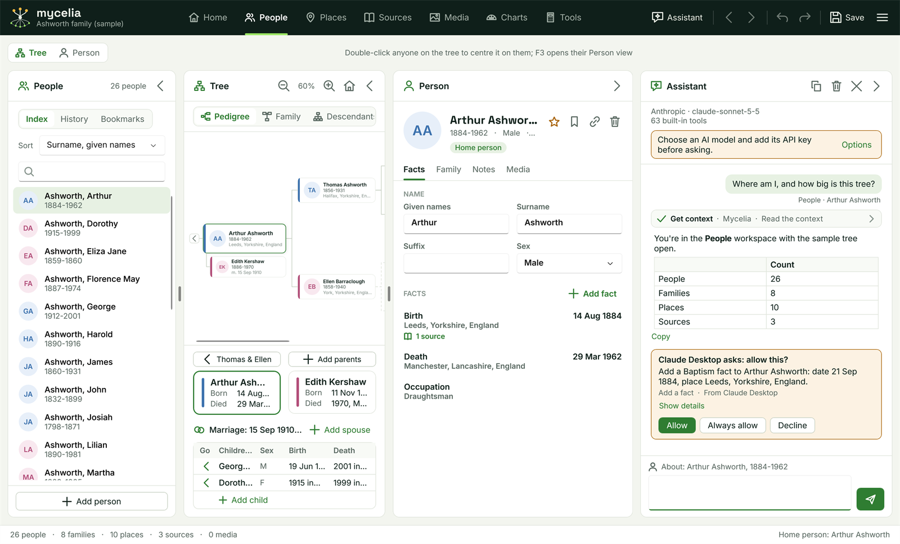
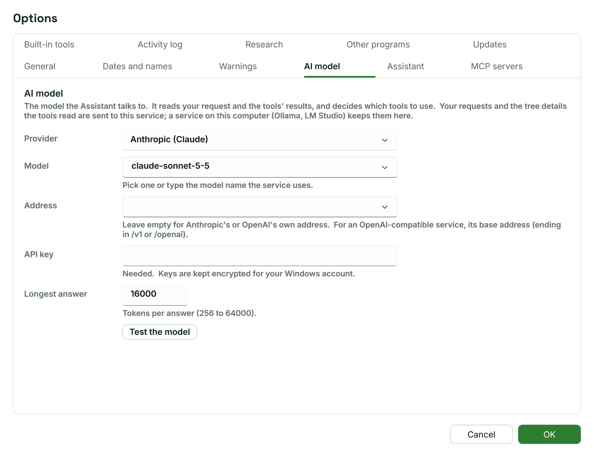
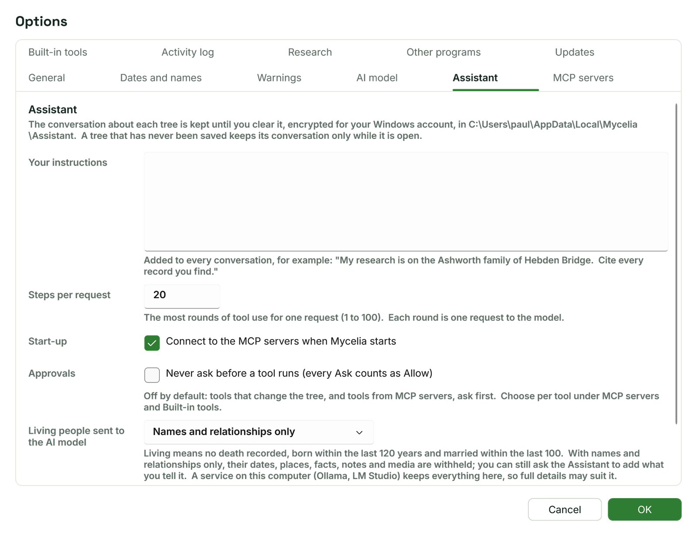

[Help home](README.md)

# The Assistant

The Assistant is a conversation with an AI model that can read your tree, change it with your approval and search record archives.  This page covers setting it up, asking, approving changes, what the AI model is told about living people, and researching with it.

## Opening the Assistant

Click **Assistant** in the top bar.  The pane opens on the right of every workspace and stays open until you close it.

- Drag the pane's left edge to make it wider or narrower.  Mycelia remembers the width.
- The fold button turns the pane into a strip on the right edge; click the strip to open it again.
- The buttons in the pane's header copy the conversation, clear it and close the pane.  **Assistant** in the top bar brings a closed pane back.

Under the header, two lines show the AI model in use (for example "Anthropic · claude-sonnet-5-5") and how many tools it has: Mycelia's built-in tools and those of any connected MCP servers.

If no AI model is set up yet, an amber banner says "Choose an AI model and add its API key before asking." with an **Options** button that opens the AI model settings.

## Choosing an AI model

The Assistant needs an AI model from a service.  Set it in Options > AI model: Main menu > Tools > Options..., then the **AI model** tab.

| Setting | What it does |
| --- | --- |
| **Provider** | **Anthropic (Claude)**, **OpenAI**, or **OpenAI-compatible (Ollama, LM Studio, Gemini, Mistral...)** for any service that works like OpenAI's, including programs on your own computer. |
| **Model** | Pick one of the suggestions or type the model name the service uses.  The default is claude-sonnet-5-5. |
| **Address** | Leave empty for Anthropic's or OpenAI's own service.  For an OpenAI-compatible service, its base address, ending in /v1 or /openai.  The list suggests `http://localhost:11434/v1` (Ollama), `http://localhost:1234/v1` (LM Studio) and the addresses for Gemini and Mistral. |
| **API key** | The key from the service's own website.  A note under the box says whether one is needed. |
| **Longest answer** | The most tokens in one answer, 256 to 64000 (16000 by default). |

**Test the model** asks the model to reply with the word OK and shows its answer and how many tokens went in and out.  If something is wrong, the service's message appears instead.

### API keys and where they are kept

Each provider keeps its own key, so you can switch between them without typing a key again.  Keys are kept in Mycelia's settings file, encrypted for your Windows account, and are never shown to the AI model.

A service on this computer (an address with `localhost` or `127.0.0.1`, such as Ollama or LM Studio) needs no key.  The pane then shows "Local AI service" as the provider.

### What goes to the service

Your requests, and the tree details the tools read, are sent to the AI service you choose.  A service on this computer keeps them here.  [What the AI model sees](#what-the-ai-model-sees) explains how living and Private people are protected.

## Asking

Type in the box at the bottom of the pane and press Enter, or click the send button.  Shift+Enter starts a new line.

Above the box, a line with a person icon says whom a request is about:

- "About: Josiah Ashworth, 1798-1871" when a person is selected.  "This person" in a request means them.
- "About: the whole tree" when nobody is selected.

The line follows the selection, so you can select Arthur Ashworth in [the People workspace](people.md) and ask "Who were this person's grandparents?".

Your message appears on the right, with where you were when you asked underneath (for example "People · Arthur Ashworth").  The AI model's replies appear on the left with simple formatting: bold, lists, tables and links that open in your browser.

You can ask it to find people, explain relationships, check for data errors, show a chart, or make changes such as "Add a baptism for Arthur Ashworth on 1 Sep 1884 at Leeds."

When a parent or partner is recorded with no name (shown as "?") and you tell the Assistant who they are, it names that record, so their family and children keep them.  It won't add another partner for someone who already has a partner with no name unless the new partner is someone else, and then the approval card says "already has a partner with no name", so you can decline.

You can also ask how to do something in Mycelia, such as "Where do I see a fact's citations?".  These help pages are built into the program, and the Assistant answers from them, naming the panels and buttons they name.  When the help doesn't cover something, it says so rather than guessing.

### Your own instructions

Options > Assistant has a box, **Your instructions**, whose text is added to every conversation.  For example: "My research is on the Ashworth family of Hebden Bridge.  Cite every record you find."

## While it works

While a request runs, a line above the box says what the Assistant is doing ("Thinking…", "Thinking about the results…", "Waiting for your answer…" or the name of the tool in use), and the send button becomes **Stop**.

Each tool the Assistant uses appears as a row: a tick when it worked, a warning sign when it failed, a cross when you declined it.  The row shows the tool, where it comes from (Mycelia, or the MCP server's name) and a short summary.  Click a row to see the arguments sent and the result that came back; click it again to hide them.

**Stop** ends the request.  Anything already changed stays changed, and can be reverted or undone as below.

One request can use the tools several times.  **Steps per request** in Options > Assistant (20 by default, 1 to 100) limits how many rounds it may take.  When it reaches the limit, the pane says so; ask it to carry on if needed.

If an answer is cut short because it is longer than the **Longest answer** setting, the pane says so.  Raise the setting in Options > AI model and type "carry on".

## Approvals

Tools that change the tree, write files or read web addresses ask first, and so do MCP servers' tools unless you choose otherwise.  The pane shows an amber card headed **Allow this?**, with a sentence saying what will happen (for example "Add a Baptism fact to Arthur Ashworth: date 1 Sep 1884, place Leeds."), the tool and its source.  **Show details** shows the arguments.  A card about a fact already in the tree gives the fact's date, such as "the Birth (Abt. 1801) of Hannah Sutcliffe", so you can see which fact a citation or change is for.  A card for linking a child says when that person is already a child of another couple, such as "Arthur Ashworth is already a child of Thomas Ashworth & Ellen Barraclough.", so you can see when the Assistant has picked someone else of the same name.

- **Allow** runs it this once.
- **Always allow** runs it, and lets this tool run without asking from now on.  You can change that again under [Built-in tools](#built-in-tools), or for an MCP server's tool in Options > MCP servers.
- **Decline** stops it.  The Assistant is told you declined and not to try again unless you ask.

When the card is for reading a web address, the middle button reads **Always allow this site** instead.  It remembers only that site (for example `https://www.freecen.org.uk`), so other sites still ask.  The sites you have allowed are listed in Options > Research, each with **Remove** (see [MCP servers](mcp-servers.md#research-settings)).

Once answered, the card shows what you chose: "Allowed", "Allowed (always for this tool)", "Allowed (always for this site)" or "Declined".

Options > Assistant has **Never ask before a tool runs (every Ask counts as Allow)**.  It is off by default; turning it on lets every tool set to Ask run without a card.

## Changes, Revert and Undo

When a request has changed the tree, the pane ends it with a line such as "4 changes to the tree.  Each is one Undo step." and a **Revert** button.

- **Revert** puts the tree back as it was before that request, in one step.  Undo then brings the changes back if you want them after all.
- Revert is refused once the tree has changed since the request ended ("The tree has changed since, so it wasn't reverted.  Undo takes changes back one at a time."), or when another tree is open.
- A conversation reopened later still shows the line, but its Revert button is gone.

Every change the Assistant makes is also one ordinary Undo step (Ctrl+Z), except bookmarks, which are never undo steps.  Changes are not saved until you save the tree; the Assistant saves only when you ask it to, and asks first.

## What the AI model sees

The tools give the AI model what it needs from your tree, but living people and anything marked Private are held back.  Set this in Options > Assistant.

**Living people sent to the AI model** has three choices:

| Setting | A living person is given as |
| --- | --- |
| **Names and relationships only** (the default) | Their name and sex, and who their parents, spouses and children are.  Dates, places, facts, notes and media are withheld. |
| **Full details** | Everything, as for anyone else. |
| **Not at all (an id only)** | "Living person", with nothing else. |

Mycelia counts a person as living when no death is recorded, they were born within the last 120 years and married within the last 100.

**Include people and facts marked Private** is off by default.  While it is off, people marked Private are withheld as living people are, and facts marked Private are left out.

Searches by date or place never match a withheld person, so their details can't be found out by searching.  You can still ask the Assistant to add what you tell it about a living person.

A service on this computer (Ollama, LM Studio) keeps everything here, so **Full details** may suit it.

The AI model is also told to search records only for people who have died, and never to put a living person's name, or anything about them, into a search, a web address or another service.

## Conversations

Each tree file has its own conversation.  When you open a tree, its conversation comes back, so you can carry on where you left off and the AI model keeps the context.

Conversations are kept on this computer, encrypted for your Windows account, in `%LocalAppData%\Mycelia\Assistant`, because they hold your family's names, dates and places.  Options > Assistant shows the folder.

A tree that has never been saved (a new tree, the sample tree, an imported GEDCOM file) keeps its conversation only while it is open; saving the tree keeps it from then on.

To start again, click the clear button in the pane's header (it asks first, and a cleared conversation can't be brought back), or type `/clear` on its own and press Enter.  A very long conversation can outgrow what the AI model accepts; the pane suggests `/clear` when that seems to be the problem.

## Copying replies

Each reply has a **Copy** button under it.  It copies the reply with its formatting, for pasting into an email or document, and as plain text; it reads "Copied" for two seconds.  The copy button in the pane's header copies the whole conversation as text.

## Researching with the Assistant

The Assistant can help you decide where to look, search open archives, bring records into the tree and cite them.

### Where to look

Mycelia has a list of research sites built in, worldwide, with each site's cost and whether a program can search it.  Ask "Where should I look for Josiah Ashworth's baptism?" and the Assistant suggests sites for the place and kind of record, and tells you which useful sites it can't search itself (sites that need a subscription or a sign-in), so you can search those on their websites.

### Archives it reads without asking

The Assistant can read these archives' own search services without an approval card:

- WikiTree
- Wikidata
- Open Archives (Open Archieven)
- The National Archives (UK) Discovery
- Trove (National Library of Australia)
- DigitalNZ (with Papers Past)
- Europeana
- GeoNames
- Internet Archive

Trove and Europeana need a free key and GeoNames a user name, entered in Options > Research (see [MCP servers](mcp-servers.md#research-settings)).  Mycelia adds the key to that archive's requests itself, so the AI model never sees it.  The names, places and dates in a search go to that archive, as they would if you searched its website yourself.

Any other web address asks first, with a card saying the address, and anything in it, goes to that site.  The Assistant can't fill in a search form or sign in to a website; when a site's search needs that, it gives you the steps instead.

You can add more archives as MCP servers: see [MCP servers](mcp-servers.md).

### Downloading records

The Assistant can download a record image or document (a register page, a certificate, a census image) into the tree's media folder and add it as a media item linked to the people concerned.  It asks first.

- The media folder is `<tree name> media`, beside the tree file.  The tree must have been saved at least once.
- A file is never overwritten; a second file of the same name gets " (2)".
- If the address gives a sign-in or error page instead of the record, the file is kept in the folder but not added to the tree.

See [Media](media.md) for working with media items.

### Citations

The AI model is told to cite every record it uses, with the source, the detail, the record's web address, the date it was accessed and a short extract.  These appear under the fact like any other citation; see [Facts, dates and sources](facts-and-sources.md).  It is told never to invent a record or web address, and to treat a record about someone of the same name as a candidate until something links it to your person.

- A record is cited on the fact for the event it records: a baptism entry on a Baptism fact, a burial entry on a Burial fact, not on the Birth or Death.  When the person has no fact for that event, the Assistant adds one and cites it there; when it can't tell what event a record is of, it asks.
- When you give it a citation to add, it puts each part in its place (the source, the record's web address, the date accessed) and adds nothing your citation doesn't say.  The extract holds only words quoted from the record.
- The date accessed must be a date Mycelia can read, such as "11 Nov 2026"; anything else is refused and the Assistant is asked to write it again.

## Built-in tools

Options > Built-in tools lists every one of Mycelia's own tools, with what it does and a column saying **Reads**, **Changes** or **Web**.  Each has a policy:

- **Allow**: used freely.
- **Ask**: you approve each use with a card.
- **Off**: not offered to the AI model.

Tools that only read are Allow by default; tools that change the tree or write files are Ask.  The tool that reads web addresses is Ask, though the listed archives and the sites you always allow run without asking.  Change a policy here to undo an **Always allow** you chose on a card.

The same policies apply when [other programs](other-programs.md) use Mycelia's tools.

## Activity log

Options > Activity log shows what the MCP servers said: connections, tool lists, calls, results and their error output, the last 1000 lines.  **Refresh** shows the latest lines and **Copy** copies the log.  Look here first when a server shows as failed; see [Questions and troubleshooting](troubleshooting.md).
