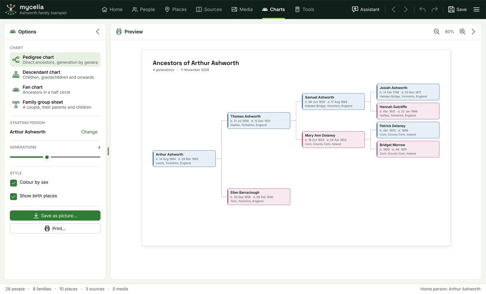

[Help home](README.md)

# Charts

The Charts workspace draws four printable charts from your tree.  This page covers each chart, the options, zooming, saving a chart as a picture and printing it.

## Opening a chart

Open the workspace with the **Charts** tab in the top bar, or Ctrl+6.  The chart starts with the person selected in the People workspace, or the home person if nobody is selected.

The workspace has two panels: **Options** on the left and **Preview** on the right.  Either can be folded to a narrow strip with the arrow button in its header.  The preview is redrawn as soon as you change an option or edit the tree.

## The four charts

Choose a chart under **CHART** in the Options panel.

- **Pedigree chart**: the starting person's direct ancestors, generation by generation from left to right.  Each box shows the name, the dates and, if you choose, the birth place.  Titled "Ancestors of" and the person's name.
- **Descendant chart**: the starting person's children, grandchildren and onwards, from the top down, with each person's children in birth order.  Each box shows the name and dates, and the first spouse on an "&" line.  It shows at most five generations.  Titled "Descendants of" and the person's name.
- **Fan chart**: the starting person's ancestors in a half circle, with the person in the centre and each generation in a ring further out.  The father's line is on the left and the mother's on the right.  Wedges for unknown ancestors are drawn as outlines.
- **Family group sheet**: one page about a couple: the starting person and their preferred spouse (the first in their spouse order).  It has a **Husband** and a **Wife** section, each with birth, baptism, christening, death, burial and occupation where recorded, and father and mother; the marriage between them; and the couple's children, numbered in birth order, with when they were born and died and whom they married.  Children who do not fit on the page are left off.  The sheet ends with the date it was prepared.

The pedigree, descendant and fan charts show the number of generations and today's date under the title.

## Options

- **STARTING PERSON**: whose chart it is.  Click **Change** to choose someone else.
- **GENERATIONS**: drag the slider to choose from 2 to 7 generations.  It starts at 4.  The descendant chart never shows more than five, and the slider does not apply to the family group sheet.
- **Colour by sex**: colours each person's box, or wedge on the fan chart, by sex (blue for men, plum for women, grey when unknown).  Untick it for plain boxes, which can be better for printing in black and white.
- **Show birth places**: adds each person's birth place to the boxes on the pedigree chart.

## Zoom

Use the zoom buttons in the **Preview** panel's header to make the preview smaller or larger, from 30% to 200%.  It starts at 80%.  Zoom changes only what you see on the screen: a saved picture or a printout is always drawn at full size.

Charts are drawn as shapes and text rather than as a picture, so they stay sharp at any zoom.

## Saving a chart as a picture

Click **Save as picture...**, choose a folder and a file name, and click **Save**.  The file name starts as the chart's title, such as "Ancestors of Arthur Ashworth".

The chart is saved as a PNG picture at 300 dots per inch, sharp enough to print or to put in a document.

## Printing

Click **Print...** and choose a printer and its settings in the Windows print window.  The chart is shrunk to fit the printable area of one page if it is too large.  A chart that already fits is printed at its normal size and never enlarged.

Large charts, such as a pedigree of seven generations, come out small on one page.  Choose a larger paper size in the print window, or save the chart as a picture instead.

## Related pages

- [The People workspace](people.md) has its own four-generation tree.
- [Set spouse order](people.md) decides which spouse the family group sheet shows.
