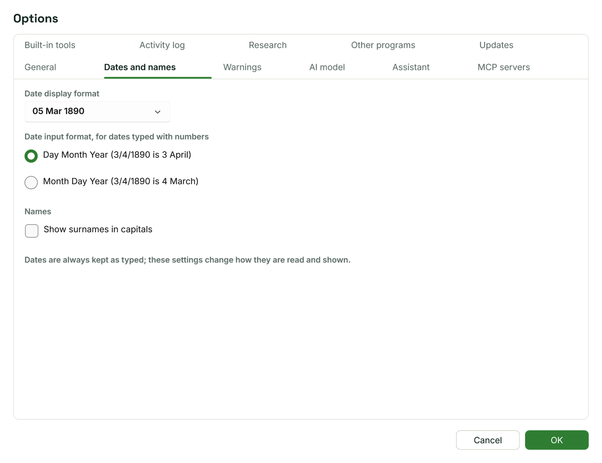

[Help home](README.md)

# Facts, dates and sources

A fact is one thing you know about a person or a couple: a birth, a baptism, an occupation, a marriage.  This page covers adding and editing facts, writing dates, places, notes, the Preferred and Private boxes, citing sources, the person's own notes and the order of spouses.

## Adding a fact

You can add a fact in two places:

- In the person panel beside the tree: the **Facts** tab, **Add fact**.
- In the Person view: **Add fact** in the heading of the facts table.

Facts that belong to a couple, such as a marriage or a divorce, are added from the couple:

- In the person panel: the **Family** tab, **Add** beside **Couple facts** on the spouse's card.
- In the Person view: **Add** in the **Shared facts with** heading for that spouse.

**Add fact** opens a menu.  The common facts come first: **Birth**, **Baptism**, **Christening**, **Death**, **Burial**, **Residence**, **Occupation**, **Census**, **Education**, **Military Service**, **Immigration**, **Emigration** and **Also Known As**.  Every other kind is under **More facts**, in alphabetical order, with your own fact types among them.  For a couple, the menu lists the couple facts: **Marriage**, **Annulment**, **Divorce**, **Divorce Filed**, **Engagement**, **Separation**, **Marriage License**, **Marriage Contract**, **Marriage Bann** and **Marriage Settlement**, and your own couple types.

The new fact is added empty and opens for editing.  The first fact of a kind is marked Preferred.

There are two kinds of fact:

- **Events,** with a date, a place and a description: Birth, Baptism, Census, Occupation, Residence, Military Service and most others.
- **Values,** a description only: Also Known As, Title, Caste, Person ID, Height, Weight, Cause of Death, Nationality, Religion, Namesake, Social Security Number, Destination and Origin.

## Editing a fact

In the person panel, click a fact to open it, and click it again to close it.  In the Person view, click its row; the form opens on the right.  The form is the same in both places:

- **Fact:** the kind of fact.  Choose another to change it, for example from Christening to Baptism.
- **Date**, with a line under it that says how Mycelia reads what you typed.  See [Writing dates](#writing-dates).
- **Place.**  See [Places](#places).
- **Description,** or **Value** for a fact that is a value only.
- **Note:** a note for this fact alone.
- **Preferred** and **Private.**  See [Preferred and Private](#preferred-and-private).
- **Sources:** the citations for this fact, and **Add source**.  See [Citing sources](#citing-sources).
- **Delete fact** removes the fact.  Mycelia does not ask first; Undo brings it back.

Changes are kept as you type.  Each box you type in counts as one change for Undo.

## Writing dates

Type a date the way you would write it.  Mycelia keeps exactly what you typed, and reads it to show it in your chosen style, to sort facts and people, and to check for unlikely dates.

**Full and partial dates.**  "14 Aug 1884", "Aug 1884" and "1884" all work.  Months can be written in full or shortened to three letters or more ("Aug", "August", "Sept"), in any case.  Dates written with numbers, such as "3/4/1890", are read day first unless you change it in Options (see [Date options](#date-options)).  When one of the numbers is over 12, that number is the day.  Write years in full.

**About, before, after and calculated.**  Put one of these in front of the date:

| You type | Shown as | Meaning |
| --- | --- | --- |
| Abt. 1850, About 1850, Circa 1850, c. 1850, Est. 1850, Approx. 1850 | Abt. 1850 | about |
| Bef. 1900, Before 1900 | Bef. 1900 | before |
| Aft. 1881, After 1881 | Aft. 1881 | after |
| Cal. 1826, Calc. 1826, Calculated 1826 | Cal. 1826 | worked out from another date, such as an age |

**Ranges.**  For a date somewhere between two others, type "Bet. 1850 and 1855", "Between 1850 and 1855", "Bet. 1850 & 1855", "From 1850 to 1855" or "1850-1855".  Every range is shown as "Bet. 1850-1855".  When both ends are in the same year, the year is shown once: "Bet. Mar and Jun 1890" is shown as "Bet. Mar-Jun 1890".

**Double dates.**  For dates before the calendar change, when the year began in March, type both years: "12 Feb 1720/21".  The second year must follow the first.  It is shown as "12 Feb 1720/21", and the later year is used for sorting and checks.

**Very old dates.**  Years up to 999 are shown with "AD"; add "BC" (or "B.C." or "BCE") for years before the common era.

### The line under the date box

As you type, the line under the **Date** box says how Mycelia reads the date:

- With an empty box, it gives examples: "Type a date such as 12 Mar 1890, Abt. 1850, Bef. 1900 or Bet. 1850 and 1855."
- With a date it can read, it shows the date in your chosen style and, for a person's fact after their birth, their age at the time: "Reads as 29 Mar 1962 · age 77".
- With a date it cannot read, it says "Not a recognised date. It will be kept as typed."

A date Mycelia cannot read is kept exactly as you typed it.  It is shown in amber in fact lists, and the warnings box lists it.  It is not used for sorting or for the checks.

### Date options

Main menu > Tools > Options..., **Dates and names** tab:

- **Date display format** sets how dates are shown: "05 Mar 1890" (the default), "5 Mar 1890", "05 March 1890", "Mar 5, 1890" or "March 5, 1890".
- **Date input format, for dates typed with numbers:** **Day Month Year (3/4/1890 is 3 April)**, the default, or **Month Day Year (3/4/1890 is 4 March)**.
- **Show surnames in capitals** shows names as "Arthur ASHWORTH".  The names in the tree are not changed.

These settings change how dates are read and shown; what you typed is never changed.  See [Options and updates](options-and-updates.md).

## Places

The **Place** box lists the places already in the tree.  Choose one, or type a name.  A name the tree does not have yet becomes a new place when you leave the box; a name it has already (in any case) uses that place.  Clear the box to remove the place from the fact.

Write places from the most local part to the largest, separated by commas: "Hebden Bridge, Yorkshire, England".  The Places workspace lists each place by its first part.

Each place is kept once and shared by every fact that uses it.  To correct a place's name everywhere, add its coordinates or combine two places, use the Places workspace.  See [Places](places.md).

## Description and value

The **Description** box holds anything the date and place do not: the occupation ("Draughtsman"), the regiment ("West Yorkshire Regiment"), the address ("14 Mill Street"), the churchyard.  For a fact that is a value only, such as Height or Religion, the box is called **Value**.

## A fact's note

The **Note** box under the description is for this fact only, for example why you think a baptism belongs to this person.  In the Person view, the **Notes** column shows 1 for a fact that has a note.

## Preferred and Private

**Preferred.**  A person can have more than one fact of a kind, for example two birth dates from different records.  The preferred one is used wherever one is needed: in the index, on the tree's cards and in charts, for sorting and for the checks.  Ticking **Preferred** on one fact clears it on the others of that kind.  When none is preferred, the first is used.  A fact that is not the preferred one of its kind is marked "alternate" in the person panel; the Person view's **Preferred** column shows which one is.

**Private.**  Tick **Private** for a fact that should stay in your tree only.  A private fact is marked "private" in the person panel and has a lock in the Person view.

- GEDCOM export leaves private facts out unless you tick **Include facts and people marked Private**.  See [GEDCOM, merging and backups](gedcom-and-backups.md).
- The Assistant's AI model is told nothing about private facts unless you change that in Options.  See [the Assistant](assistant.md).

## Citing sources

A citation says where a fact came from: which source, where in it, and what the record says.  Under **Sources** in the fact form, choose **Add source** to open the **Add source citation** window:

- **Source:** choose a source already in the tree.  To describe a new one, tick **Create a new source instead** and fill in **New source title**, **Author or originator** and, if it is an online database or catalogue, **Source web address**.
- **Citation detail (page, folio, entry):** where in the source, such as "RG11/4512, folio 33, page 12".
- **Record's web address:** the address of the record itself, if it is online.  Web addresses start with https:// or http://.
- **Accessed (date):** when you looked at it.  **Today** fills in today's date.
- **Text (a transcription or extract of the record):** what the record says, in full or in part.

Choose **Add**.  You need a source, or a title for a new one; everything else is optional.

The fact form lists each citation with the source's title, the detail, the web address (click it to open the record in your browser), the date accessed and the start of the extract.  Click a citation to change its details in the **Edit source citation** window; its source stays the same.  The cross beside a citation removes it from the fact.  The source stays in the tree.

The fact lists show how many sources each fact has, and the Home workspace shows how many people have at least one.  The sources themselves (title, author, publisher, repository) are edited in the Sources workspace, which also lists every citation of each source.  See [Sources](sources.md).

## The person's notes

Notes about the person as a whole go in the person panel's **Notes** tab or the **Notes** panel under the Person view's facts table.  Both show the same notes.  They are separate from the notes on each fact.

## Your own fact types

When none of the built-in kinds fits, make your own, such as "Apprenticeship".  Choose Main menu > Edit > **Manage fact types...**

The window lists every fact type in alphabetical order, each marked **Individual** or **Shared (couple)** and **built in** or **your own**, with how many facts use it.  Select a type to see it.

- **New fact type** asks for a name.  A new type belongs to individuals and has a date and place.
- For your own types you can change the **Name**, choose whether it **Belongs to** individuals or couples (only while no fact uses it), and untick **Has a date and place** to make it a value only.
- **Delete this type** removes a type no fact uses.  If facts use it, change or delete those facts first.
- Built-in types cannot be changed.

Changes take effect at once, and Undo reverses them.  Your own types are saved with the tree and appear in the **Add fact** menu under **More facts** (or in the couple menu for a shared type).  They are written to GEDCOM files and read back from them.

## Spouse order

When someone has more than one spouse or partner, you can set the order they come in.  The first is the preferred spouse: shown first in the tree, the family panel and charts.  Without an order set, the **Family** tab and the Person view list spouses by marriage date, undated marriages last.

To set the order, select the person and choose Main menu > Person > **Set spouse order...**, or **Set spouse order...** on the person panel's **Family** tab.  The window lists the spouses with their marriage dates, the first marked **Preferred**.  Select a spouse and use **Move up** and **Move down**, then choose **OK**.  The new order is one undo step.
