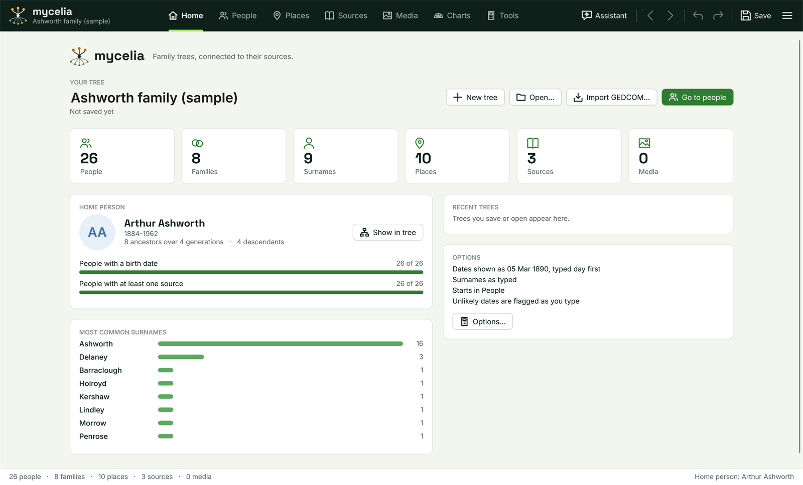

[Help home](README.md)

# Getting started

This page covers installing Mycelia, what you see when it first starts, and how to make, open, import and save a tree.  It also explains undo and the parts of the top bar.

## Installing

Mycelia runs on Windows 10 or 11, 64-bit.

**With the installer.**  Download the installer from the [Releases page](https://github.com/paulfilkin/mycelia/releases): under **Assets** on the newest release, click `MyceliaSetup-<version>.exe`, for example `MyceliaSetup-0.2.0.exe`.  Releases marked "Pre-release" are test builds.

Run the file you downloaded.  It installs Mycelia for your Windows account only, so it needs no administrator rights.  It adds a Start menu shortcut and, if you tick **Create a desktop icon**, a desktop shortcut.  The installer includes everything Mycelia needs; you do not have to install .NET.

The installer is not code-signed, so Windows may stop it with "Windows protected your PC".  Click **More info**, check that the app is `MyceliaSetup-<version>.exe`, then click **Run anyway**.  Your browser may also ask whether to keep the download; choose to keep it.

Once Mycelia is installed it finds and installs new versions itself.  See [Options and updates](options-and-updates.md).

**From source.**  Install the [.NET 10 SDK](https://dotnet.microsoft.com/download), then from a command prompt:

```
git clone https://github.com/paulfilkin/mycelia.git
cd mycelia
dotnet build Mycelia.sln -c Debug
dotnet run --project familyTree/Mycelia.csproj
```

The repository's README says how to build the installer yourself.

Uninstalling leaves your settings and Assistant conversations in place, so a reinstall keeps them.  Your trees are wherever you saved them and are never touched.

## The first start

When Mycelia starts it opens the tree you used most recently, if the file still exists.  The first time, or when there is no recent tree, it opens the sample tree, "Ashworth family (sample)".  The Ashworths are an invented family of 26 people over six generations, starting with Josiah Ashworth (1798-1871).  The home person is Arthur Ashworth (1884-1962).  Use the sample tree to try things out; nothing in it is real.

Mycelia starts in the People workspace.  You can change both of these in Main menu > Tools > Options... on the **General** tab: **Start in this workspace** and **Open the most recent tree when starting**.  See [Options and updates](options-and-updates.md).

To go back to the sample tree at any time, choose Main menu > Open sample tree.

## The top bar



From left to right, the dark bar at the top of the window holds:

- **The tree's name.**  Once the tree is saved this is its file name.  When there are changes you have not saved, "unsaved changes" follows the name.
- **The workspace tabs:** **Home**, **People**, **Places**, **Sources**, **Media**, **Charts** and **Tools**.  Each tab opens a workspace; the rest of this help has a page for each.
- **Update available** (or **Update required**), only when a newer version has been found.  See [Options and updates](options-and-updates.md).
- **Assistant** shows or hides the Assistant pane on the right.  See [the Assistant](assistant.md).
- **Back** and **Forward** arrows step through the people you have selected, like a web browser's back and forward buttons.
- **Undo** and **Redo**.
- **Save**.
- **The main menu**, the button with three lines at the right-hand end.  Pointing at it shows "File".  The help writes its items as Main menu > Import and export > Export GEDCOM...

In a narrow window the **Assistant** and **Save** buttons, and then the workspace tabs, show only their icons.  Point at a tab to see its name.

The status bar along the bottom of the window shows how many people, families, places, sources and media items the tree has, and the home person.

## The main menu

The main menu holds everything that is not on a workspace:

- **New tree**, **Open...**, **Save** and **Save as...**
- **Import and export:** **Import GEDCOM...**, **Merge another tree into this one...**, **Export GEDCOM...**, **Export a branch...**, **Back up with media...** and **Restore a backup...**  See [GEDCOM, merging and backups](gedcom-and-backups.md).
- **Edit:** **Find and replace...**, **Manage fact types...**, **Relationships...** and **Historical events...**
- **Person:** **Back**, **Forward**, **Go to home person**, **Make home person**, **Add bookmark** (or **Remove bookmark**), **Set spouse order...**, **Merge two people...** and **Delete** followed by the selected person's name.
- **Tools:** **Find duplicate people...**, **Sort all children by birth...**, **Convert names...**, **Check for updates...** and **Options...**
- **Help:** **Help for this screen**, **All help**, **Keyboard shortcuts** and **Report a problem or suggest an idea...**
- **Open sample tree** and **Exit**.

## The Home workspace

Home shows the open tree at a glance:

- **Your tree:** the tree's name, which you can click and rename, and where the file is saved ("Not saved yet" for a new tree).  The buttons beside it are **New tree**, **Open...**, **Import GEDCOM...** and **Go to people**.
- **Six cards** with the number of people, families, surnames, places, sources and media items.  Click a card to open its workspace.
- **Home person:** their portrait, name and dates, how many ancestors and descendants they have, and **Show in tree**.  Two bars show how many people have a birth date and how many have at least one source.
- **Most common surnames:** the eight surnames used most in the tree.
- **Recent trees:** up to eight trees you have saved or opened.  Click one to open it.
- **Options:** a summary of how dates and surnames are shown, the start-up workspace and whether unlikely dates are flagged, with an **Options...** button.

## Starting a new tree

Choose **New tree** on Home, Main menu > New tree, or press Ctrl+N.  Mycelia opens an empty tree called "New family tree" in the People workspace.  Choose **Add first person** in the middle of the Tree panel, or **Add person** under the index.  The first person you add becomes the home person.

To rename the tree, click its name on Home and type.  See [The People workspace](people.md) for adding relatives.

## Opening a tree

Choose **Open...** on Home, Main menu > Open..., or press Ctrl+O.  Mycelia trees are `.ftree` files.  You can also choose a GEDCOM file (`.ged`) here; it is imported as described below.  A tree you opened recently is also listed under **Recent trees** on Home.

Mycelia has one tree open at a time.  If the open tree has unsaved changes, Mycelia asks whether to save them first.

## Importing a GEDCOM file

GEDCOM is the standard file format for moving a family tree between programs.  To bring a tree in from another program, export it from there as GEDCOM, then in Mycelia choose Main menu > Import and export > Import GEDCOM..., or **Import GEDCOM...** on Home.

The imported tree replaces the open one (Mycelia asks to save the open one first if it has changes).  Mycelia reports how many people and families it read.  The imported tree is not saved until you save it, and the first save asks for a file name.

To add a GEDCOM file to the tree you already have, rather than replace it, use Main menu > Import and export > Merge another tree into this one...  See [GEDCOM, merging and backups](gedcom-and-backups.md).

## Saving

Nothing is saved until you save.  Mycelia does not save automatically.

- **Save** in the top bar, Main menu > Save, or Ctrl+S, saves the tree to its file.  The first time, it asks where to save it and what to call it.
- Main menu > **Save as...** saves the tree under a new name or in a new place, and carries on with the new file.

Mycelia keeps no copy of the previous version when it saves.  To keep a copy of the tree with its pictures and documents, use Main menu > Import and export > **Back up with media...**  See [GEDCOM, merging and backups](gedcom-and-backups.md).

When you close Mycelia, or start a new tree, open, import or restore one, while the open tree has unsaved changes, Mycelia asks whether to save them: **Yes** saves, **No** discards them and **Cancel** goes back.

Bookmarks, the History list, your own fact types and historical events are saved in the tree file with everything else.

## Undo and redo

Every change to the tree can be undone: **Undo** in the top bar or Ctrl+Z, and **Redo** or Ctrl+Y.  Mycelia remembers the last 60 changes.

- Typing in a box counts as one change, from when you click into the box until you leave it.
- A change made with a button or a window, such as adding a person or merging two people, is one change, however much it does.
- Making a new change after an undo clears what you could redo.
- Saving does not clear the undo history.  Opening another tree does.
- Adding or removing a bookmark is not an undo step.  Changes in the Options window are not undo steps either.

## Back and Forward

Each time you select a different person, Mycelia remembers the one before.  **Back** (Alt+Left) returns to the previous person and **Forward** (Alt+Right) goes the other way.  People you have deleted since are skipped.  Opening another tree clears Back and Forward.

## Where to go next

- [The People workspace](people.md): the index, the tree, the person panel and the Person view.
- [Facts, dates and sources](facts-and-sources.md): recording what you know, and where you found it.
- [Places](places.md), [Sources](sources.md), [Media](media.md) and [Charts](charts.md).
- [Tools](tools.md): relationships, dates, duplicates and data checks.
- [GEDCOM, merging and backups](gedcom-and-backups.md).
- [The Assistant](assistant.md), [MCP servers](mcp-servers.md) and [Other programs](other-programs.md).
- [Options and updates](options-and-updates.md).
- [Keyboard shortcuts](keyboard-shortcuts.md).
- [Questions and troubleshooting](troubleshooting.md).
