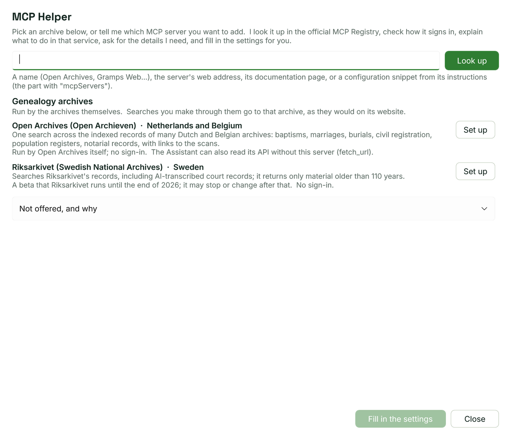
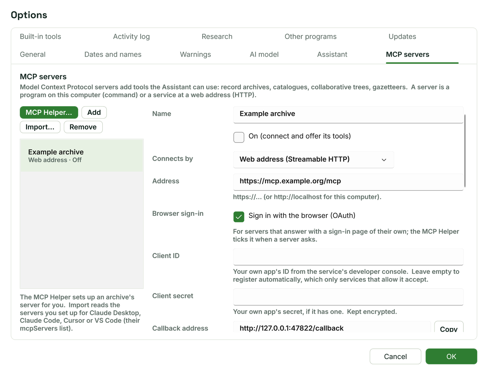
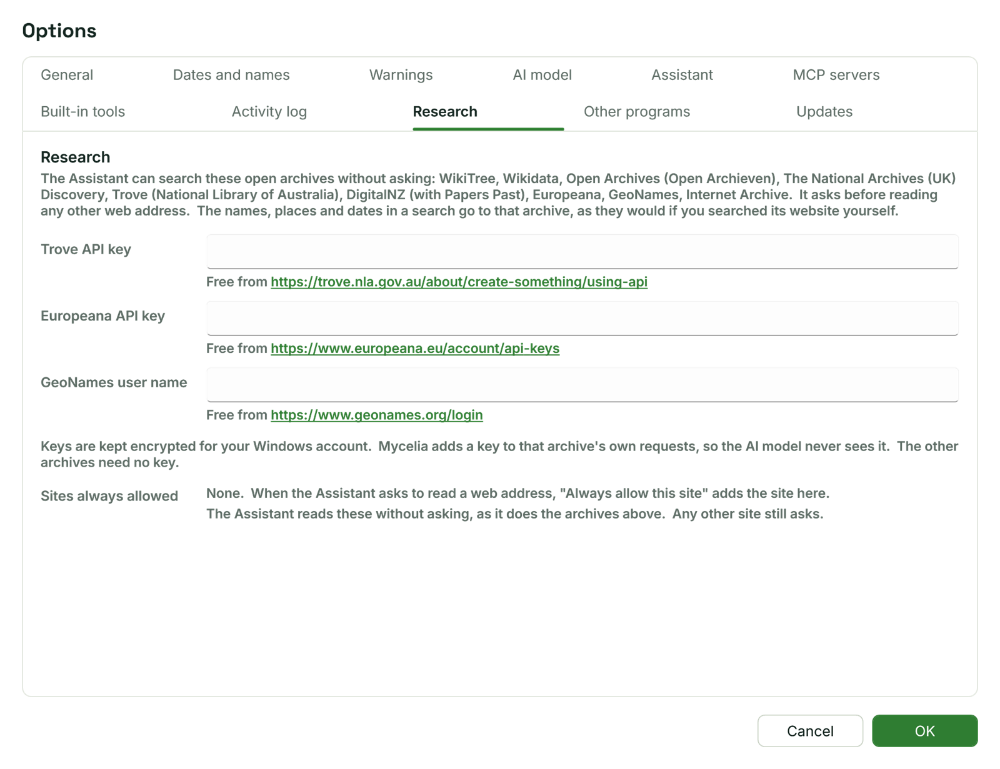

[Help home](README.md)

# MCP servers

MCP servers give [the Assistant](assistant.md) more tools, such as searching an archive's records.  This page covers setting them up with the MCP Helper or by hand, signing in, and the Research settings for the archives the Assistant reads directly.

## What an MCP server is

MCP (Model Context Protocol) is a common way for a program to offer tools to an AI model.  An MCP server is either:

- a service at a web address, run by an archive or another organisation, or
- a program that runs on your computer and that Mycelia starts for you.

Once a server is connected, its tools appear beside Mycelia's own.  The Assistant's pane counts them under its header, and each tool the Assistant uses shows the server's name in its row.  A server's tools ask before they run unless you choose otherwise.

Searches you make through a server go to whoever runs it.

## The MCP Helper

Open Options > MCP servers and click **MCP Helper...** at the top of the list.  The Helper sets up a server for you, step by step.

### Genealogy archives

At the top, **Genealogy archives** lists servers run by the archives themselves, each with a **Set up** button:

| Server | Covers | Notes |
| --- | --- | --- |
| Open Archives (Open Archieven) | Netherlands and Belgium | Indexed records of many Dutch and Belgian archives, with links to the scans.  No sign-in. |
| Riksarkivet (Swedish National Archives) | Sweden | Riksarkivet's records, including AI-transcribed court records; only material older than 110 years.  A beta that Riksarkivet runs until the end of 2026.  No sign-in. |

**Set up** checks how the server signs in and prepares the settings.

**Not offered, and why** opens a list of other servers for family history that the Helper does not set up, each with the reason.  Among them:

- Servers for WikiTree, Wikidata and Europeana are not needed, because the Assistant reads those archives directly (see [Research settings](#research-settings)).
- Australian History (Trove and others): its source code is no longer public, so what it does with your searches can't be checked.  The Assistant reads Trove directly with your Trove key.
- FamilySearch: FamilySearch grants its API only to approved partners, and some of these servers reuse your browser's sign-in, outside FamilySearch's terms.  Search FamilySearch on its website.
- Arolsen Archives: built on the archive's undocumented addresses, and the archive's terms forbid reusing its material elsewhere without consent.
- NARA (US National Archives): its repository is gone.

### Naming any server

To set up a server that is not in the list, type into the box at the top and click **Look up**.  You can give:

- a name, such as Open Archives or Gramps Web, which the Helper looks up in the official MCP Registry;
- the server's web address;
- a documentation page that describes the server;
- a configuration snippet from the server's instructions (the part with "mcpServers"), pasted whole, braces included.

When several registry entries match, **Which one do you mean?** lists them with the closest chosen; pick another if it is not the one.  If an entry is published by someone other than the company you named, the Helper says so: your searches would go through their service.

The Helper then checks how the server signs in and, under **Instructions**, shows notes about it.  With an AI model set up in Options > AI model, it also writes **What to do**: the steps to follow in that service.  **Ask the helper**, under the steps, takes questions about them.  **Copy instructions** copies the notes, steps and answers, formatted, to paste into an email or a document.

If the server needs details from you, such as a key, they are asked under **Details to enter**.  Secret details are typed into password boxes and kept encrypted.  In a pasted configuration, placeholders such as `<YOUR_TOKEN>` become questions.

### Filling in the settings

Click **Fill in the settings**.  It refuses while a required detail is missing and names what is still needed.  The Helper closes and fills in:

- the selected server, if it is still empty (no address or command), or
- a new server in the list.

The line under the server's buttons then tells you what to do next: press **Sign in** under Browser sign-in if the server needs it, then **Test connection**.  Click **OK** in Options to keep the server.

## Adding a server by hand

Options > MCP servers lists your servers, each with its kind (**Web address** or **Command**) and its status.  The buttons above the list are **MCP Helper...**, **Add**, **Import...** and **Remove** (which asks first).

**Add** makes a new server called "New server".  Fill in its settings on the right:

| Setting | What to enter |
| --- | --- |
| **Name** | A name you will recognise. |
| **On (connect and offer its tools)** | Untick to keep the server without using it. |
| **Connects by** | **Web address (Streamable HTTP)** for a service, or **Command on this computer (stdio)** for a program. |
| **Wait for answers** | Seconds to wait for the server to answer (60 by default). |
| **New tools** | The policy for tools you haven't chosen for yet: **Allow**, **Ask** or **Off**. |
| **Allow tools the server marks read-only without asking** | Lets tools that the server says only read run without a card. |

For a web address:

- **Address**: the server's address, starting `https://` (or `http://localhost` for a server on this computer).
- **Browser sign-in** and **Header sign-in**: see below.
- **Headers**: `Name: value`, one per line.  Values are kept encrypted.

For a command:

- **Command**: for example `npx`, `uvx`, `node`, `python`, or a program's full path.
- **Arguments**: one per line, for example `-y` and the package name.
- **Start in folder**: optional.
- **Environment**: `NAME=value`, one per line, for keys the server needs.  Values are kept encrypted.

Only add a command from a source you trust: it runs as a program on your computer.

### Testing and choosing tools

**Test connection** connects to the server and lists its tools under **Tools**, each with what it does (**Reads**, **Changes** or **Deletes**) and its policy: **Allow**, **Ask** or **Off**.  **Allow all** and **Ask for all** set every tool at once.  If the test fails, the server's error output is shown under the buttons; the [Activity log](assistant.md#activity-log) has the full record.

Click **OK** to save.  Servers connect when you click OK and, while **Connect to the MCP servers when Mycelia starts** is ticked in Options > Assistant (the default), each time Mycelia starts.

### Importing servers

**Import...** reads the servers you set up for Claude Desktop, Claude Code, Cursor or VS Code from their configuration file (their "mcpServers" list).  It opens at Claude Desktop's file when there is one.  Servers with a name already in your list are left out.

If the file includes Mycelia itself, that entry shows as failed and is not connected: the Assistant already has Mycelia's tools.

### Browser sign-in

Some services answer with a sign-in page of their own.  For these, tick **Sign in with the browser (OAuth)**.  The MCP Helper ticks it for you when a server asks for it.

- **Client ID** and **Client secret**: your own app's details from the service's developer console.  Leave the client ID empty to register automatically; only services that allow it accept that.  The secret is kept encrypted.
- **Callback address**: register this exact address as your app's redirect address.  **Copy** copies it.  Mycelia listens on it only while you sign in.
- **Scopes**: space-separated.  Empty asks for what the server lists.
- **Extra parameters**: `name=value`, one per line, added to the sign-in address.
- **Name the server in the sign-in (resource parameter)**: leave ticked unless the service refuses it.

Click **Sign in**.  Your browser opens the service's sign-in page; sign in there and allow Mycelia.  While Mycelia waits, the button reads **Stop waiting**.  When it is done, the status line says "Signed in", with when the sign-in runs out and whether it is renewed on its own.  **Sign out** forgets the sign-in.

Sign-in details are kept encrypted and renewed automatically where the service allows it.  If the service refuses a renewal, sign in again.

### Header sign-in

For a server that takes a key or token rather than a sign-in page, **Header sign-in** makes the Authorization header for you: choose **Basic: user name and token** or **Bearer: token**, type the details and click **Set header**.  You can also type the header into **Headers** yourself.  When a server refuses a connection because it needs a key, Mycelia's message says to add an Authorization header.

## Research settings

Options > Research is for the open archives the Assistant reads directly, without an MCP server.

The page lists the archives the Assistant can search without asking: WikiTree, Wikidata, Open Archives (Open Archieven), The National Archives (UK) Discovery, Trove (National Library of Australia), DigitalNZ (with Papers Past), Europeana, GeoNames and the Internet Archive.  It asks before reading any other web address.  The names, places and dates in a search go to that archive, as they would if you searched its website yourself.

Three of these need something from you, each free from the link under its box:

- **Trove API key**
- **Europeana API key**
- **GeoNames user name**

Keys are kept encrypted for your Windows account.  Mycelia adds a key to that archive's own requests, so the AI model never sees it.  The other archives need no key.  If you ask the Assistant to search Trove, Europeana or GeoNames before the key is set, it says which key to add here.

### Sites always allowed

When the Assistant asks to read a web address and you choose **Always allow this site**, the site is added under **Sites always allowed**.  The Assistant then reads that site without asking, as it does the archives above; any other site still asks.  Click **Remove** beside a site to have the Assistant ask again, then **OK**.
