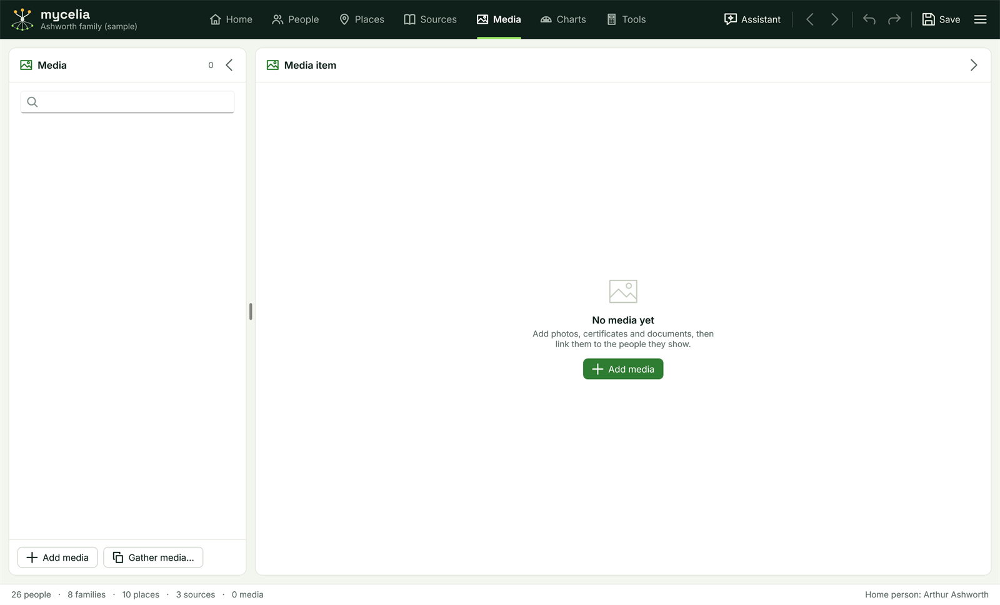

[Help home](README.md)

# Media

The Media workspace holds the pictures, documents and recordings linked to your tree.  This page covers adding media, previews and captions, portraits, linking people, missing files, gathering your files into one folder, and the media folder the Assistant downloads into.

## Media are links to files

Mycelia does not copy your files.  Each media item is a link to a file where it already is on your computer, recorded by its full path, such as C:\Users\you\Pictures\Family\wedding 1910.jpg.

This means:

- Moving, renaming or deleting the file breaks the link.  The item then shows "File not found" until you use **Find file...** (see below).
- A tree opened on another computer shows "File not found" for every item, because the paths point to the first computer.
- Removing an item from the tree never deletes the file.

To move a tree together with its files, use **Back up with media...** and **Restore a backup...**: see [GEDCOM, merging and backups](gedcom-and-backups.md).  To bring files from several folders into one, use **Gather media...** (see below).

## The list

Open the workspace with the **Media** tab in the top bar, or Ctrl+4.

The **Media** panel on the left lists every item by caption, with a small picture and the number of people linked to it.  An item whose file cannot be found shows "File not found" instead of the number of people.  Type in the search box to show only items whose caption or file path contains what you type.

Click an item to see it in the **Media item** panel on the right.

## Adding media

Click **Add media** at the foot of the list.  You can choose several files at once.  The file window offers pictures (JPG, PNG, BMP, GIF and TIFF), PDF documents, sound and video (MP3, WAV and MP4), and text and Word documents (TXT, DOC and DOCX), or any file under **All files**.

Each file becomes one item, with its file name as the caption.  A file already in the tree is skipped.

You can also link a file from a person.  In the People workspace, the person panel's **Media** tab has **Link a media file...**, which adds the file (if it is not in the tree yet) and links it to that person in one step.

## An item's details

The **Media item** panel shows:

- **A preview** of a picture.  Other files, such as PDFs, show an icon and "No preview"; a missing file shows "File not found" and the path it was looked for at.
- **Open file**: opens the file in the program Windows uses for that type of file.
- **Find file...**: points the item at a file in a new place (see below).
- **Remove from tree**: removes the item and its links to people.  The file itself is not deleted.
- **Caption**: the item's name in the list and on the person's **Media** tab.
- **Date** and **Category**: when the item dates from, and what kind of item it is (for example "Census", "Certificate" or "Photograph").  Both are free text.
- **Description**: anything else about it.
- The full path of the file.
- **PEOPLE IN THIS ITEM**: everyone linked to it (see below).

Changes are saved with the tree, and Undo (Ctrl+Z) reverses them.

## People in an item

Click **Link a person** and choose who appears in, or is described by, the item.  A picture of a family can be linked to everyone in it.

Each linked person is listed with:

- **Portrait**: tick it to use this picture as the person's portrait, shown in the person panel, the tree and elsewhere.  A person has one portrait, so ticking it here replaces any other.  Only pictures can be portraits.
- An unlink button, which removes the person from this item (and clears their portrait if it was this picture).

In the People workspace, the person panel's **Media** tab shows the same links from the person's side: their portrait with **Choose picture...** and **Remove portrait**, and their linked media.  Clicking a linked item there opens the Media workspace.

## File not found and Find file...

When a file has been moved or renamed, or the tree has come from another computer:

1. Select the item marked "File not found".
2. Click **Find file...**.
3. Find the file and click **Open**.

The item now points at the file's new place.  Its caption, date, description and people stay as they were.  You need to do this for each item; restoring a backup sets all the paths for you.

## Gathering media into one folder

A tree imported from GEDCOM, or built up over years, often links to files in many different folders.  **Gather media...** copies them all into one folder, so you can keep them together and back them up.

1. Click **Gather media...** at the foot of the Media list, or choose Main menu > Import and export > Gather media....
2. Check the **Folder**.  It starts as the tree's media folder (see below), or is empty for a tree that has never been saved.  Type or paste another path, or click **Change...** to choose one.  A folder that does not exist yet is made.
3. Read the summary under the folder: how many files will be copied, how many items are already in that folder, and how many files cannot be found.
4. Click **Copy and relink**.

Mycelia copies each file into the folder, then points every item at its copy.  When it has finished it says how many items now point at the folder, and lists any files it could not find.

- **The originals are not moved or deleted.**  Once you have checked the folder, you can delete them yourself.
- **Nothing in the folder is overwritten.**  A file with the same name as one already there is copied as "name (2)", and so on.  This happens often with files from other programs, where several files can be called "1911 England Census.jpg".
- A file that two items link to is copied once, and both items point at the copy.
- Items whose files are already in the folder are left as they are.
- Items whose files cannot be found keep their old paths.  Use **Find file...** for those.
- If a file cannot be copied, the copies already made are removed and the tree is not changed.
- **Undo** (Ctrl+Z) points the items back at the originals.  The copies stay in the folder.

The items still record full paths.  If you later move the folder, or open the tree on another computer, the items show "File not found" again until you use **Find file...** or restore a backup.

## The tree's media folder

Records the [Assistant](assistant.md) downloads are saved in the tree's media folder: a folder named after the tree with " media" on the end, beside the tree file.  For a tree saved as Ashworth.ftree, it is the folder "Ashworth media" in the same place.

- The folder is made the first time the Assistant downloads something into it, or the first time you gather media into it.
- The tree must have been saved at least once, so that the folder has somewhere to go.
- A download never overwrites a file already there.  A second file with the same name is saved as "name (2)", and so on.
- Each downloaded file is added to the tree as a media item, with the file name as the caption and "Downloaded from" and the address as the description unless the Assistant gives others, and linked to the people it is about.
- By default the Assistant asks before it downloads a file.

The items it adds are ordinary media items with full paths, like any other.  Moving the tree and its media folder to another place still needs **Find file...** or a backup.

## Related pages

- [The People workspace](people.md)
- [GEDCOM, merging and backups](gedcom-and-backups.md)
- [The Assistant](assistant.md)
