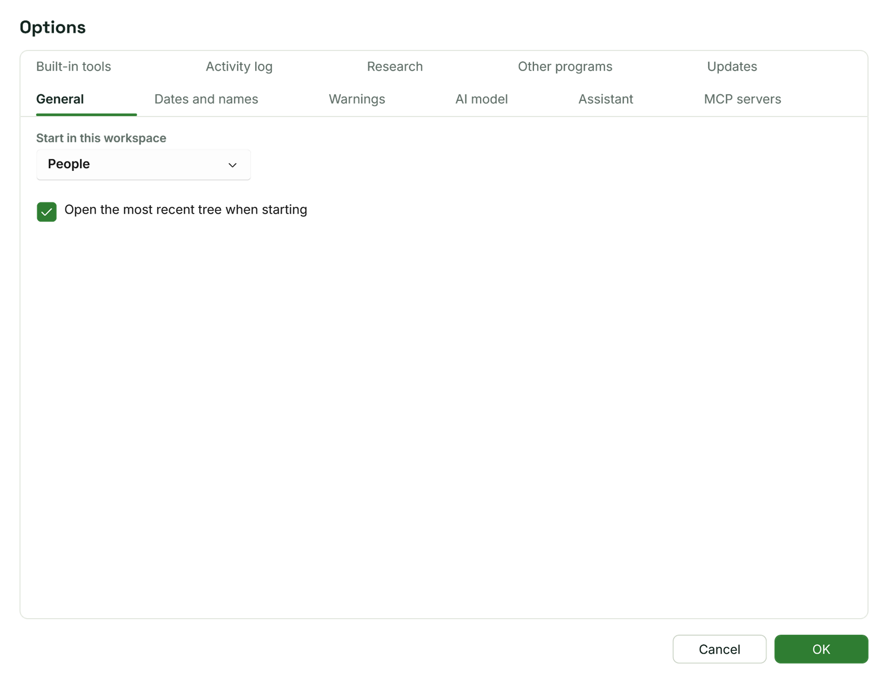
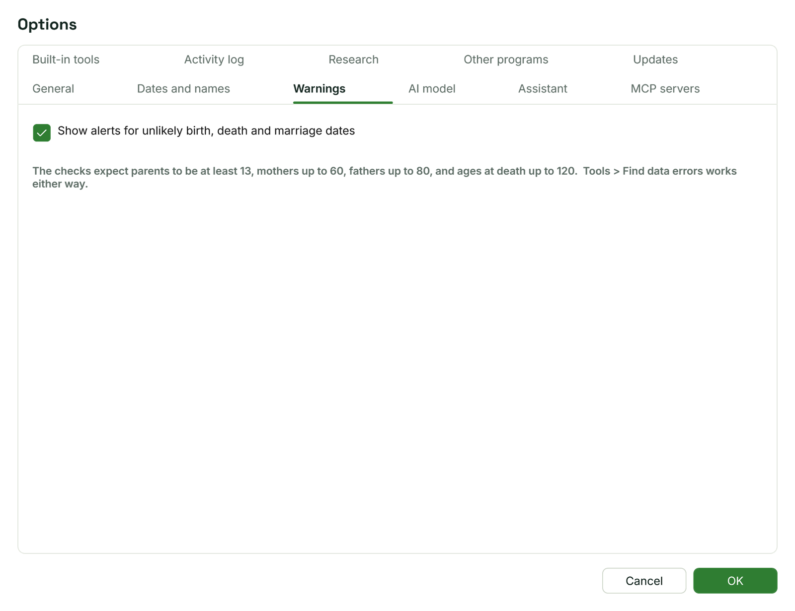
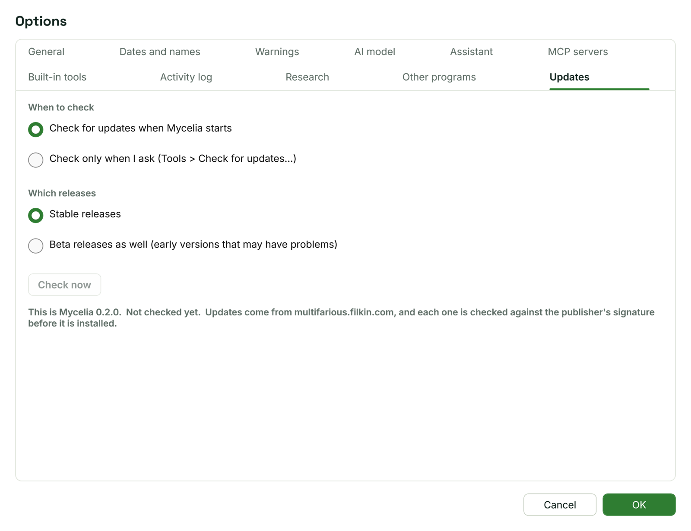

[Help home](README.md)

# Options and updates

This page covers the Options window's general tabs (General, Dates and names, Warnings and Updates) and how Mycelia checks for, downloads and installs new versions of itself.

Open the Options window with Main menu > Tools > Options... (the main menu is the menu button at the right of the top bar), or with **Options...** on the Home workspace's Options card.

Click **OK** to save your changes; they take effect at once.  **Cancel** closes the window without changing anything.

The other tabs, **AI model**, **Assistant**, **MCP servers**, **Built-in tools**, **Activity log**, **Research** and **Other programs**, are about the Assistant.  They are covered on [the Assistant](assistant.md), [MCP servers](mcp-servers.md) and [Other programs](other-programs.md) pages.

## General

- **Start in this workspace**: the workspace Mycelia shows when it starts (Home, People, Places, Sources, Media, Charts or Tools).  The default is People.
- **Open the most recent tree when starting**: ticked at first.  When ticked, Mycelia opens the tree you used last, if the file is still there.  When unticked, or when the file has gone, it opens the sample tree.

## Dates and names

Dates in Mycelia are always kept exactly as you type them.  These settings change only how dates are read and shown, so you can change them at any time without changing your tree.

- **Date display format**: how dates are shown everywhere in the program.  The list shows 5 March 1890 in each style:
  - 05 Mar 1890 (the default)
  - 5 Mar 1890
  - 05 March 1890
  - Mar 5, 1890
  - March 5, 1890
- **Date input format, for dates typed with numbers**: how a date such as 3/4/1890 is read.
  - **Day Month Year (3/4/1890 is 3 April)**: the default.
  - **Month Day Year (3/4/1890 is 4 March)**.

  A number over 12 can only be a day, so 25/12/1890 and 12/25/1890 are both read as 25 December whichever you choose.  Dates with the month in letters, such as 3 Apr 1890, are never in doubt.
- **Show surnames in capitals**: shows surnames in capitals, such as "Arthur ASHWORTH", in the index, the person panel and elsewhere.  The names stored in your tree do not change.  To change the stored names, use [Convert names](tools.md#convert-names).

## Warnings

- **Show alerts for unlikely birth, death and marriage dates**: ticked at first.  When ticked, the person panel in the People workspace shows a box at the top listing any problems with the person you are looking at, such as a birth after a death or a mother under 13, and missing details such as an unknown birth date.  Untick it to hide the box.

The checks expect parents to be at least 13, mothers up to 60, fathers up to 80, and ages at death up to 120.

**Find data errors** in the Tools workspace works whichever you choose, and runs the same checks over the whole tree.  See [Find data errors](tools.md#find-data-errors).

## Updates

Mycelia can find, download and install new versions of itself.

### Settings

- **When to check**:
  - **Check for updates when Mycelia starts**: the default.
  - **Check only when I ask (Tools > Check for updates...)**.
- **Which releases**:
  - **Stable releases**: the default.
  - **Beta releases as well (early versions that may have problems)**.
- **Check now**: checks straight away, using the releases you have chosen on this tab, even before you click **OK**.

Below these, the tab shows the version you are running and when Mycelia last checked.

### Checking at start-up

When Mycelia starts, it checks quietly in the background, without opening a window.  If a newer version is available, an **Update available** button appears in the top bar, to the left of the other buttons; for a version you must install, it reads **Update required**.  Hover over it to see the version.  Click it to see the update and install it.

The button stays at every start until you install that version or a later one.  While it is showing, Mycelia does not check again at start-up; clicking the button checks again.  Changing **Which releases** clears it, and the next check finds what the new choice offers.

### Checking by hand

Main menu > Tools > Check for updates... checks at once and always tells you the result:

- "You have the latest version of Mycelia", with your version number;
- a message saying it could not check, with the reason;
- or the **Software update** window, when a newer version is available.

### Installing an update

The **Software update** window shows the new version, your current version, when it was published and, under **What's new**, the release notes.  A beta release is marked as such.  There may also be a **Release notes** link to read more in your browser.

1. Click **Download and Install**, which shows the size of the download.  A progress bar follows the download; **Cancel** stops it.
2. When the download is complete, Mycelia checks that it is the genuine release (see below).
3. If your tree has unsaved changes, you are asked whether to save them, as when you close Mycelia.  **Cancel** stops the update and nothing changes.
4. Mycelia closes, the new version is installed, and Mycelia starts again.

Click **Later** to close the window without installing.  The **Update available** button stays, so you can install it another time.

For an update marked as required, the window says your current version is no longer supported.  You can still choose **Later**.

Installing does not ask for administrator rights, because Mycelia is installed for your Windows account only.

### How updates are checked

Updates come from multifarious.filkin.com.  Each one is checked against the publisher's signature before it is installed:

- the file must be exactly the size the release states;
- its checksum must match the one published with the release;
- its digital signature must match the publisher's key, which is built into Mycelia.

If any check fails, the downloaded file is deleted, nothing is installed, and the window says why.  Downloaded installers are kept in a temporary folder and deleted the next time Mycelia starts.

When Mycelia checks for updates, it sends only its own version number and whether you want stable or beta releases.  Nothing about you or your tree is sent.

## Where settings are kept

Your settings are saved in settings.json in the Mycelia folder of your Windows profile (%AppData%\Mycelia).  If the file is missing or cannot be read, Mycelia starts with the default settings.

## Related pages

- [Getting started](getting-started.md)
- [Tools](tools.md)
- [Questions and troubleshooting](troubleshooting.md)
