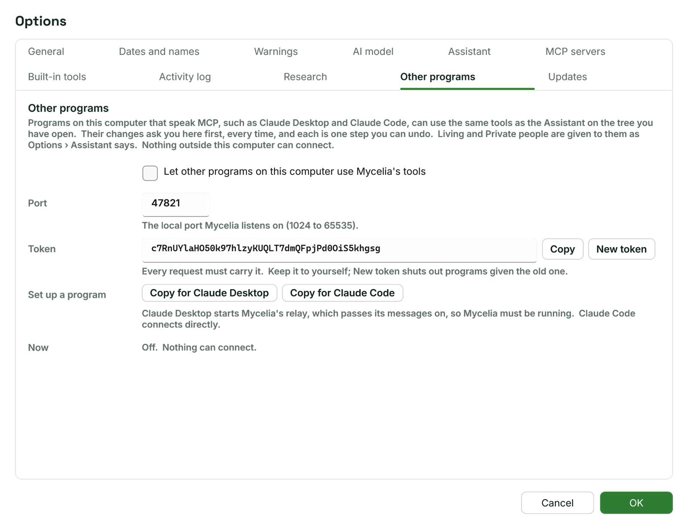

[Help home](README.md)

# Other programs

Programs on your computer that speak MCP (Model Context Protocol), such as Claude Desktop and Claude Code, can use Mycelia's tools on the tree you have open.  This page covers turning this on, setting up those programs, and what they can and cannot do.

## What it does

When it is on, another program's AI model can use the same built-in tools as [the Assistant](assistant.md): search people, read a person's facts, check for data errors, add facts and citations, and so on.  The other program uses its own AI model; Mycelia's AI model and API key are not used.

- It is off until you turn it on.
- Nothing outside this computer can connect, and web pages in your browser can't reach it.
- Every change asks you in Mycelia first, every time, and each change is one step you can undo.
- Living and Private people are given to other programs exactly as Options > Assistant says (see [What the AI model sees](assistant.md#what-the-ai-model-sees)).

## Turning it on

Open Options > Other programs.



1. Tick **Let other programs on this computer use Mycelia's tools**.
2. Leave **Port** as it is unless another program already uses it.  It must be a number from 1024 to 65535 (47821 by default).
3. Click **OK**.

Mycelia then listens at `http://127.0.0.1:47821/mcp` (with your port number if you changed it).

**Token** is the key every request must carry.  **Copy** copies it.  **New token** makes a new one; programs set up with the old one are shut out until you give them the new one.  Keep the token to yourself.

The **Now** line says whether it is on and which programs are connected.

## Setting up Claude Desktop

Claude Desktop starts Mycelia's relay, a copy of Mycelia that opens no window and passes Claude Desktop's messages to the Mycelia you have open.  Mycelia must be running.

1. In Options > Other programs, click **Copy for Claude Desktop**.
2. In Claude Desktop, choose Settings > Developer > Edit Config.
3. Paste what you copied inside the `"mcpServers"` section of the file, save it, and restart Claude Desktop.

What you paste looks like this, with the full path to Mycelia on your computer in place of the dots:

```json
"mycelia": {
  "command": "C:\\...\\Mycelia.exe",
  "args": [ "--mcp-relay" ]
}
```

The relay reads the port and token from Mycelia's settings, so the token is not in Claude Desktop's file.

If Claude Desktop reports an error from Mycelia, it is one of these:

- Other programs are switched off: turn them on in Options > Other programs, then connect again.
- Mycelia isn't open, or isn't letting other programs in: open Mycelia, check Options > Other programs, then try again.
- Mycelia was restarted since the connection began: reconnect to start again.

## Setting up Claude Code

Claude Code connects to Mycelia directly.

1. In Options > Other programs, click **Copy for Claude Code**.
2. Run the copied command in a terminal.  Claude Code then lists mycelia under `/mcp`.

The command has this form, with your port and token in it:

```
claude mcp add --transport http mycelia http://127.0.0.1:47821/mcp --header "Authorization: Bearer <token>"
```

If you click a Copy button before the feature is on, the **Now** line reminds you to tick the box and press OK first.

## Other MCP programs

Any program that speaks MCP can connect in one of two ways:

- over Streamable HTTP, at `http://127.0.0.1:<port>/mcp`, sending the header `Authorization: Bearer <token>` with every request;
- by starting Mycelia with `--mcp-relay` and talking to it on standard input and output, as Claude Desktop does.

## Approvals appear in Mycelia

When another program asks to use a tool set to Ask, Mycelia opens the Assistant pane (restoring and bringing the window forward if needed) and shows an approval card headed, for example, **Claude Desktop asks: allow this?**, with a sentence saying what will happen and "From Claude Desktop".  Answer it with **Allow**, **Always allow** or **Decline**, as for the Assistant (see [Approvals](assistant.md#approvals)).

- A card not answered within five minutes counts as declined.
- **Never ask before a tool runs** in Options > Assistant does not apply to other programs: their changes always ask.
- Reading a web address that is not one of the listed archives or a site you always allow asks too.

Each tool the program uses appears as a row in the Assistant pane, marked "From" and the program's name.  These rows are kept with the tree's conversation, but they are not part of the Assistant's own conversation with its AI model.

## What other programs can and cannot do

They can:

- use Mycelia's built-in tools on the tree that is open, with each tool's policy from [Built-in tools](assistant.md#built-in-tools);
- read, search and, with your approval, change the tree, save it, export GEDCOM and download records;
- read the listed archives that the Assistant reads without asking (see [Research settings](mcp-servers.md#research-settings)).

They cannot:

- use a tool you have set to **Off** under Built-in tools;
- use the tools of the MCP servers set up in Options > MCP servers: those are for the Assistant only;
- see more of living or Private people than Options > Assistant allows;
- connect from another computer, or without the token.

Each change is one Undo step.  The Assistant's **Revert** button belongs to its own requests only, so use Undo (Ctrl+Z) to take back a change made by another program.

## The status bar

While other programs are switched on, the status bar shows "Other programs: on", or "Connected: Claude Desktop" while a program is connected.  Hover over it to see the address.

If the port is already in use by another program, the status bar says other programs can't connect because the port is in use, and the [Activity log](assistant.md#activity-log) records it.  Choose another port in Options > Other programs, click **OK**, and run the Claude Code command again with the new address.  Claude Desktop's relay reads the port from Mycelia's settings, so restart Claude Desktop.

## Turning it off

Untick **Let other programs on this computer use Mycelia's tools** in Options > Other programs and click **OK**.  Nothing can connect after that, and Claude Desktop's relay answers that other programs are switched off.

After **New token** and **OK**, programs given the old token can no longer connect.  Copy the Claude Code command again and run it with the new token.  Claude Desktop's relay reads the token from Mycelia's settings, so restarting Claude Desktop is enough.
