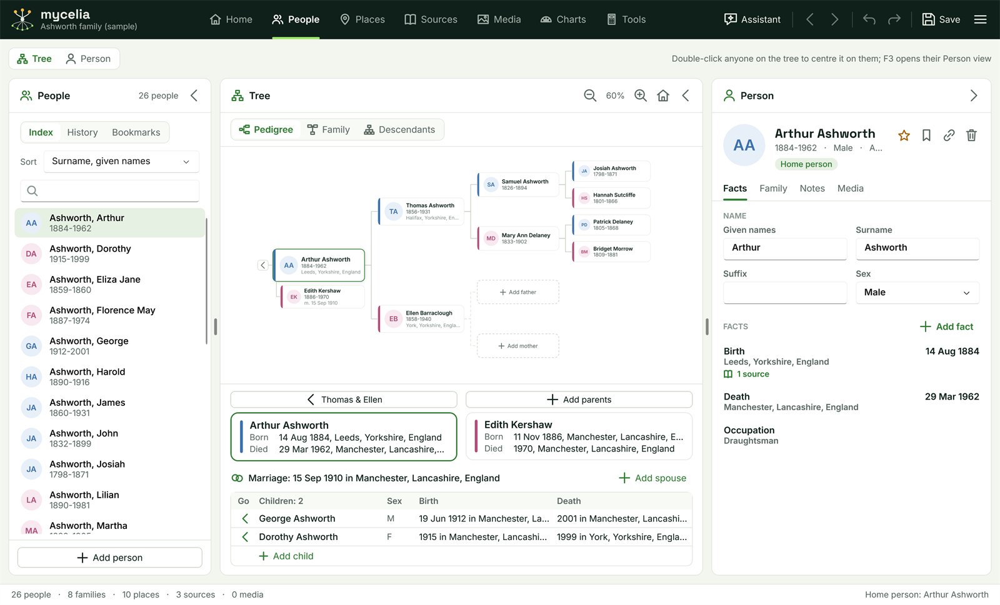
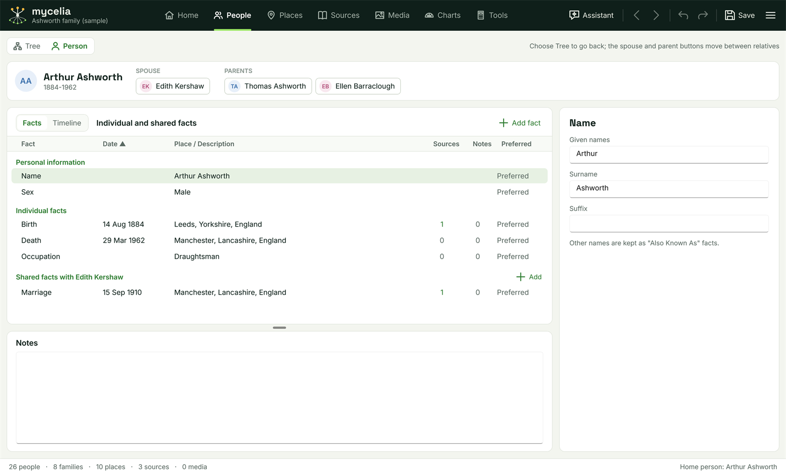

[Help home](README.md)

# The People workspace

The People workspace is where you add people, link them into families and record what you know about them.  This page covers the index, the Tree view, the person panel and the Person view.

The switch at the top left chooses between two views:

- **Tree** shows three panels side by side: the index (**People**), the **Tree** and the person panel (**Person**).
- **Person** shows one person's facts in a table, with their timeline and notes.  See [The Person view](#the-person-view).

Each of the three Tree view panels can be folded to a narrow strip with the arrow button in its header, to give the others more room.  Click anywhere on a folded strip to open it again.  Drag the gap between two open panels to change their widths.  Mycelia remembers what you fold and how wide you make each panel.  In a narrow window Mycelia folds panels itself, starting from the left, so that none is cut off.

## The index

The **People** panel on the left lists the people in the tree.  Its header shows how many are listed, or how many match a search ("12 of 26").

At the top, three buttons choose the list:

- **Index:** everyone in the tree.
- **History:** the people you have selected, each listed once.  Mycelia keeps the last 400 selections and saves them with the tree.  Looking at someone does not count as an unsaved change, so the history is written to the file the next time you save.
- **Bookmarks:** the people you have bookmarked.  See [Bookmarks](#bookmarks).

**Sort** orders the list:

- **Surname, given names** (the default), then by birth date.
- **Given names, surname**, then by birth date.
- **Birth date**, **Marriage date** or **Death date**, then by name.  People without that date come after everyone who has one.  Where someone has more than one birth, marriage or death, the preferred one is used.

The History and Bookmarks lists use the same sort order.

The search box under it filters the list as you type.  It matches names in either order, years in the life span ("1884") and birth places ("Leeds").

Each entry shows the person's initials on a disc coloured by sex (blue for male, plum for female, grey for unknown), their name with the surname first, and their years.  Click an entry to select that person and centre the tree on them.  Double-click it to open their Person view.  Right-click it, or press Shift+F10 or the Menu key, for [the right-click menu](#the-right-click-menu).

**Add person** at the bottom adds someone who is not yet linked to anyone.  Give a given name or a surname (or both), the sex, and if you know them, the birth and death dates and places.  Then link them to their relatives from the person panel's **Family** tab.

## The Tree view

The **Tree** panel in the middle draws the selected part of the tree around one person, the person it is centred on.  Three buttons under the panel header choose the drawing:

- **Pedigree:** the person and their ancestors over four generations, left to right, fathers above mothers.  The person's spouse is under them, with a caption such as "m. 1910", "div. 1902", "Partner" or "Friend".  A card in the last column with an arrow has more ancestors; click the arrow to move the tree up to that person.  When the person in the first column has children, a button with an arrow on their left moves the tree down: with one child it goes straight to them, and with several it lists them in birth order to choose from.  The family strip is shown under the pedigree (see below).
- **Family:** the person's parents above, the person and their spouse in the middle with the marriage date between them, and their children below, in birth order, up to four to a row.
- **Descendants:** the person, their children and their grandchildren, in birth order.  Each card is captioned with the person's first spouse.

Each person is a card with a coloured strip for their sex, their portrait or initials, their name, their years and, where there is room, their birth place.  Point at a card to see the birth, the death and how the person is related to the home person.

- **Click** a card to select that person.  The person panel shows them; the tree stays where it is.
- **Double-click** a card to centre the tree on that person.  You stay in the Tree view; to open their Person view, press F3 or use the right-click menu.
- **Right-click** a card to select that person and open [the right-click menu](#the-right-click-menu).

A dashed card is an empty place: **Add father**, **Add mother**, **Add spouse** or **Add child**.  Click it to add that person.

### Zoom

The panel header has **Zoom out** and **Zoom in** buttons with the zoom level between them, and a home button that centres the tree on the home person.  You can also zoom with Ctrl and the mouse wheel, from 50% to 200%.

Until you zoom yourself, Mycelia fits the drawing to the panel.  Click the zoom level to fit it again.

### The family strip

Under the pedigree, the family strip shows the person and their spouse side by side:

- **The couple.**  Each partner's card shows their birth and death.  Click a card to select that partner, or double-click to centre the tree on them.  Above each card, a button names their parents ("Thomas & Ellen"); click it to centre the tree on the father, or on the mother when there is no father.  If no parents are recorded, the button reads **Add parents** and adds the father first.  Without a spouse, the right-hand side is an **Add spouse** card.
- **The marriage line:** the marriage date and place, and the couple's status when it is not ongoing ("(Divorced)").  When the person has more than one spouse, a button such as **Spouse 1 of 2** shows the next one.  **Add spouse** adds another.
- **The children table:** each child with their sex, birth and death.  The arrow in the **Go** column centres the tree on that child.  Click a row to select the child, or double-click to centre the tree on them.  **Add child** at the bottom adds a child to this couple.

The couple's cards and the children's rows have the right-click menu too.

## The right-click menu

Right-click a person anywhere in the Tree view (a card on the tree, a partner's card or a child's row in the family strip) or in the index.  Mycelia selects them and shows a menu of what you can do with them:

- **Open Person view** and **Centre the tree here**.
- **Make home person.**  It reads **This is the home person**, greyed out, when they already are.  See [The home person](#the-home-person).
- **Add bookmark** or **Remove bookmark**.
- **Add relative:** **Father...**, **Mother...**, **Spouse or partner...**, **Child...** or **Sibling...**  See [Adding relatives](#adding-relatives).
- **Link existing person:** **As a parent...**, **As a spouse or partner...** or **As a child...**
- **Set spouse order...**
- **Merge with another record...** opens the merge window with this person on the left.
- **Delete** the person.  Mycelia asks first.

These do the same as the buttons on the person panel and the **Family** tab, and each change is one undo step.

## The person panel

The **Person** panel on the right shows the selected person and lets you change them.  Its header shows:

- Their portrait, name, years, sex and age (at death, or today's age if they have no death recorded).
- How they are related to the home person, for example "Father of Arthur Ashworth", or "Home person".
- Four buttons:
  - The star makes this person the home person.
  - The bookmark button adds or removes a bookmark.  It is green when the person is bookmarked.
  - The link button opens the merge window with this person on the left, for when the same person has been entered twice.  See [Tools](tools.md) and [GEDCOM, merging and backups](gedcom-and-backups.md).
  - The bin deletes the person.  Mycelia asks first.  Their relatives stay in the tree, and Undo brings the person back.

Under the header are four tabs.

### Facts

The **Facts** tab holds:

- **The warnings box,** when there is something to check.  Each line with a warning sign is a likely mistake, for example "Born when the mother was over 60." or "Burial date before death date."  A **To complete** line lists what is missing, such as a birth date.  The box updates as you type.  You can turn it off in Options, on the **Warnings** tab; Tools > Find data errors checks the whole tree either way.  See [Tools](tools.md).
- **Name:** **Given names**, **Surname**, **Suffix** and **Sex**.
- **Facts:** every fact recorded for the person, by date, with undated facts last.  Each row shows the fact, its place and description, how many sources it has, and the date.  A date Mycelia cannot read is shown in amber.  "alternate" marks a fact that is not the preferred one of its kind, and "private" a private fact.  Click a fact to open it for editing, and click it again to close it.  **Add fact** adds a new one.

How to add and edit facts, write dates and cite sources is on [Facts, dates and sources](facts-and-sources.md).

### Family

The **Family** tab shows the person's relatives and how they are linked:

- **Parents:** each parent with a box for how the person is related to them (**Natural**, **Adopted**, **Step**, **Foster**, **Related**, **Guardian**, **Sealed**, **Private** or **Unknown**).  **Detach from these parents** removes the link without deleting anyone.  Below are **Add father** and **Add mother** (when one is missing) and **Link existing parent**.
- **Spouses and children:** a card for each spouse or partner.  Each card has:
  - The spouse, with the marriage date, or **Add spouse** when the other partner is unknown.
  - **Relationship** (**Spouse**, **Partner**, **Friend**, **Single**, **Other**, **Unknown** or **Private**) and **Status** (**Unknown**, **Ongoing**, **Divorced**, **Deceased**, **Separated**, **Annulled**, **Private**, **Other** or **None**).
  - **Couple facts**, such as the marriage, with **Add** for a new one.  They are edited in the same way as the person's own facts.
  - **Children**, in birth order, each with a box for how the child is related to this person and a button to detach the child from the family.  When the last child is detached from a family with no spouse and no couple facts, the family is removed, so no empty **Unknown spouse** card is left.
  - **Add child**, **Link existing child** and **End this link**.  **Link existing child** lists everyone except this family's own children, so a child recorded in the person's other family can be added to this one; detach them from the other family afterwards.  **End this link** removes the spouse from the person's family without deleting anyone; any children stay with the person.
- Under the cards: **Add spouse**, **Link existing spouse** and, with two or more spouses, **Set spouse order...**  See [Facts, dates and sources](facts-and-sources.md#spouse-order).
- **Siblings:** each brother or sister with how they are related ("brother", "half sister"), and **Add sibling**.

Click any relative's name or picture to go to them.

### Notes

The **Notes** tab is a box for anything about the person that is not a fact: family stories, research notes, questions still open.  These are the person's own notes; each fact also has a note of its own.

### Media

The **Media** tab shows:

- **Portrait:** the picture used for the person on cards and in lists.  **Choose picture...** picks a picture file; **Remove portrait** stops using it.
- **Linked media:** the pictures and documents linked to the person.  Click one to go to the Media workspace.
- **Link a media file...** links another file.

Mycelia links to files where they are; it does not copy them.  See [Media](media.md).

## Adding relatives

You can add a relative from several places: the dashed cards on the tree, the family strip, the **Family** tab, the top of the Person view and the right-click menu's **Add relative**.  Each opens the same window, titled **Add father**, **Add mother**, **Add spouse**, **Add child** or **Add sibling**, with:

- **Given names**, **Surname** and **Sex**.  Mycelia fills in what it can: a father and a child take the family surname, a sibling the person's surname, and the sex is chosen for a father, a mother and a spouse.  Change anything that is wrong.
- **Birth date**, **Birth place**, **Death date** and **Death place**, if you know them.  Mycelia records them as the new person's birth and death facts.

Choose **Add person**.  The new person is linked and selected, and the person panel shows them.

- A child is added to the family you added them from.  **Add child** on someone with no spouse makes a family with only that parent.
- A spouse added to someone who has a family with only one parent joins that family, so its children gain a second parent.
- A sibling is added to the person's parents' family.  If the parents are not recorded, Mycelia makes a family with no parents to hold the two siblings.

To link someone who is already in the tree, use **Link existing parent**, **Link existing spouse** or **Link existing child** on the **Family** tab.  A window lists everyone who could be linked, with a search box; double-click a name, or select it and choose **Choose**.

Every addition or link is one change, so Undo reverses it.

## Bookmarks

A bookmark keeps someone you come back to often at hand.  To add or remove one, use the bookmark button in the person panel's header, the right-click menu, Main menu > Person > **Add bookmark** (or **Remove bookmark**), or Ctrl+Shift+B.  The **Bookmarks** list in the index shows everyone you have bookmarked.

Bookmarks are saved with the tree.  Adding or removing one counts as an unsaved change, but it is not an undo step: Undo and Redo leave your bookmarks as they are.

## The home person

The home person is the person the tree starts from.  Relationships on the person panel and in the tree's tooltips are given relative to them, and the status bar names them.  In the sample tree it is Arthur Ashworth.

- To change it, right-click the person on the tree or in the index and choose **Make home person**.  Or select them and click the star in the person panel's header, or choose Main menu > Person > **Make home person**.  This is an undo step.
- To go to the home person, press Ctrl+Home, choose Main menu > Person > **Go to home person**, or click the home button in the Tree panel's header.

The first person added to an empty tree becomes the home person.  If you delete the home person, the first person in the tree takes their place.

## Merging two people

When the same person has been entered twice, merge the two records into one.  This is covered on [Tools](tools.md) and [GEDCOM, merging and backups](gedcom-and-backups.md).

## The Person view

The Person view shows everything about one person on a single screen.  To open it:

- choose **Person** in the switch at the top left of the People workspace,
- double-click a person in the index,
- right-click a person on the tree or in the index and choose **Open Person view**, or
- press F3.

Choose **Tree** to go back.  The tree is centred on the person you were last looking at.

### Across the top

The person's portrait, name and years, then:

- **Spouse:** a button for each spouse or partner, or **Add spouse** when there is none.
- **Parents:** a button for the father and the mother, with **Add father** or **Add mother** when one is missing.

Click a spouse or parent to show them in the Person view.

### The facts table

The table lists the person's facts in groups:

- **Personal information:** the name and sex, then any Also Known As, Title and Person ID facts.
- **Individual facts:** every other fact about the person.
- **Shared facts with** each spouse: the couple's facts, such as the marriage.  **Add** in the group heading adds a couple fact.  The spouses are in the person's spouse order when one is set, otherwise in order of marriage date.

The columns are **Fact**, **Date**, **Place / Description**, **Sources** (the number of citations), **Notes** (1 when the fact has a note) and **Preferred** ("Preferred" on the preferred fact of each kind).  A lock beside a fact means it is private.  A date Mycelia cannot read is shown in amber.

Within each group the facts are in date order, undated facts last.  Click the **Fact**, **Date**, **Place / Description** or **Sources** heading to sort by that column, and click it again to reverse the order.  The name and sex stay at the top.

**Add fact** in the panel heading adds a fact for the person.

### Details

Click a row to edit it in the panel on the right:

- **Name:** **Given names**, **Surname** and **Suffix**.  Other names are kept as Also Known As facts.
- **Sex:** a box with **Male**, **Female** and **Unknown**.
- **A fact:** its heading ("Marriage of Thomas Ashworth & Ellen Barraclough" for a couple fact) and the same form as in the person panel.  See [Facts, dates and sources](facts-and-sources.md).

### The timeline

The **Facts** and **Timeline** switch in the panel heading swaps the table for the person's life in date order.  Each entry shows the date, a dot, the event and the person's age at the time.  The dots are dark green for the person's own facts, light green for family events and amber for historical events.

- **Family events** adds the births and deaths of parents, spouses, children and siblings during the person's life.  Click one to show that relative.
- **Historical events** adds events from the tree's list of historical events that fall within the person's life.  **Historical events...** opens the list, where you can add the standard list or your own events.

Someone with no death recorded is taken to have lived 100 years, to decide which events fall within their life.

### Notes

The **Notes** panel under the table holds the person's own notes, the same notes as the person panel's **Notes** tab.  Drag the gap above it to make it taller or shorter.
