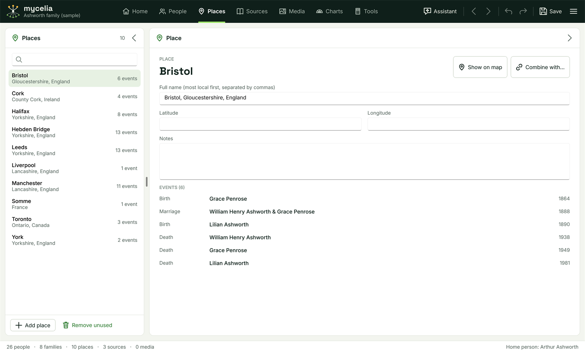

[Help home](README.md)

# Places

The Places workspace lists every place used in your tree.  This page covers finding a place, editing it, seeing who was there, combining two places and opening a place on a map.

## The list

Open the workspace with the **Places** tab in the top bar, or Ctrl+3.

The **Places** panel on the left lists every place in alphabetical order.  Each row shows the first part of the name (for example "Hebden Bridge"), the rest of the name underneath ("Yorkshire, England") and how many events took place there.  The number in the panel's header is the count of places, or "12 of 40" while a search is narrowing the list.

Type in the search box at the top of the list to show only the places whose full name contains what you type.  Searching for "Yorkshire" shows Hebden Bridge, Halifax, Leeds and York in the sample tree.

Click a place to see its details in the **Place** panel on the right.  Either panel can be folded to a narrow strip with the arrow button in its header, to make room for the other.

## Where places come from

You rarely need to add a place by hand.  When you type a place into a fact in the People workspace, Mycelia uses the existing place with that name (capitals do not matter) or creates a new one.  See [Facts, dates and sources](facts-and-sources.md).

To add a place yourself, click **Add place** at the foot of the list and type its name.

## Place names

A place has one full name, written from the most local part to the widest, separated by commas:

- Hebden Bridge, Yorkshire, England
- Cork, County Cork, Ireland
- Toronto, Ontario, Canada

The part before the first comma is used as the place's short name in the list and as the heading of its details.  Writing every place the same way keeps the list in order and makes duplicates easy to spot.

## A place's details

The **Place** panel shows:

- **Full name (most local first, separated by commas)**: the name used everywhere the place appears.  Changing it here changes it on every fact that uses the place.
- **Latitude** and **Longitude**: optional coordinates, as decimal numbers (for example 53.74 and -2.01).
- **Notes**: anything you want to record about the place.
- **EVENTS**: every fact at this place, in date order, with the fact type, whose fact it is and the date.  Click an event to go to that person in the People workspace.  For a shared fact such as a marriage, the first partner is selected.

Changes are saved with the tree, and Undo (Ctrl+Z) reverses them.

## Show on map

Click **Show on map** to open OpenStreetMap in your web browser.  When the place has a latitude and longitude, the map opens at those coordinates; otherwise OpenStreetMap searches for the place's full name.  Nothing is changed in your tree.

## Combining places

The same place is often entered in two ways, such as "Leeds, Yorkshire, England" and "Leeds, Yorks".  To make them one:

1. Select the place you want to get rid of.
2. Click **Combine with...**.
3. Choose the place to keep from the list (type to narrow it) and click **Choose**.

Every fact at the first place moves to the one you chose, and the first place is removed.  If the place you keep has no coordinates, it takes the coordinates of the one removed.  Undo reverses the whole step.

## Removing unused places

Click **Remove unused** at the foot of the list to delete every place that no fact uses, unless it has coordinates or notes.  Mycelia tells you how many it removed.  Undo brings them back.

## Related pages

- [The People workspace](people.md)
- [Facts, dates and sources](facts-and-sources.md)
- [Find and replace](tools.md#find-and-replace) also searches place names.
