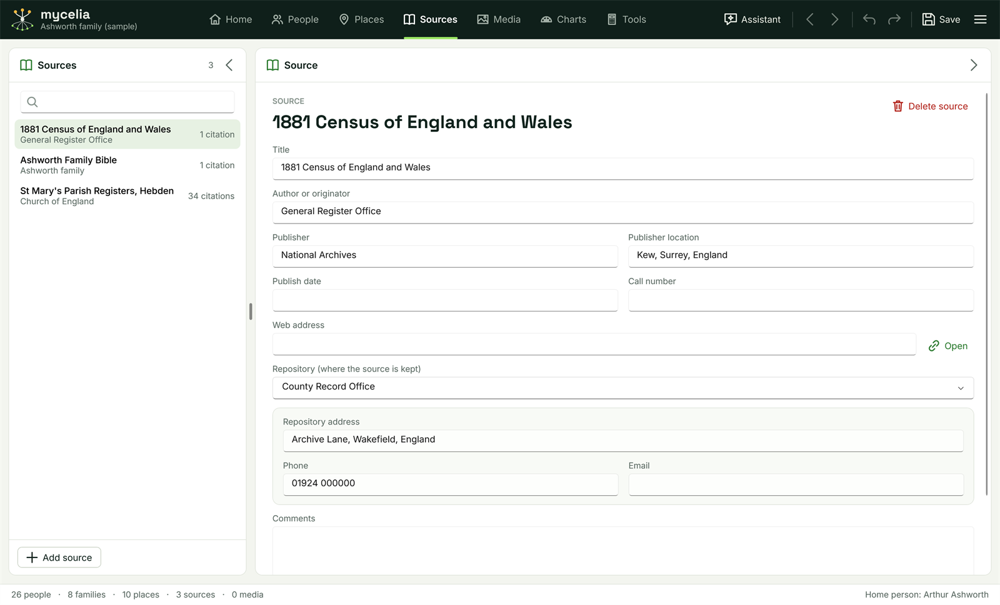

[Help home](README.md)

# Sources

The Sources workspace lists the records, books and registers your facts come from, and where each one is kept.  This page covers sources and repositories, their fields, and the citations that link facts to them.

## Sources, repositories and citations

- A **source** is a record you got information from: "1881 Census of England and Wales", "St Mary's Parish Registers, Hebden" or "Ashworth Family Bible" in the sample tree.
- A **repository** is where a source is kept, such as a record office or library.  Several sources can share one repository.
- A **citation** links one fact to a source and says where in the source the fact was found: a page, a folio, an entry, or a single record online.

You add citations from a fact in the People workspace.  The Sources workspace is where you edit the sources themselves and see which facts cite each one.

## The list

Open the workspace with the **Sources** tab in the top bar, or Ctrl+5.

The **Sources** panel on the left lists every source by title, with its author underneath and the number of citations to it.  Type in the search box to show only the sources whose title or author contains what you type.  Click a source to see its details in the **Source** panel on the right.

To add a source, click **Add source** at the foot of the list and give it a title.  You can also create a source while adding a citation to a fact (see below).

## A source's details

- **Title**
- **Author or originator**: a person or a body, such as "General Register Office".
- **Publisher** and **Publisher location**
- **Publish date**
- **Call number**: the reference the repository uses for it.
- **Web address**: where the source can be found online, such as an online database, a catalogue entry or a digitised book.  Click **Open** beside it to open the address in your web browser.  An address must start with https:// or http:// to open.
- **Repository (where the source is kept)**: choose a repository from the list, or type a new name to create one.  Clear the box to remove the link.  Once a repository is chosen, its **Repository address**, **Phone** and **Email** appear underneath.  These belong to the repository, so a change here shows on every source kept there.
- **Comments**: anything else about the source, such as the years it covers.

Changes are saved with the tree, and Undo (Ctrl+Z) reverses them.

## The facts that cite a source

Under **CITATIONS**, the source's details list every fact that cites it, sorted by the name of the person or couple.  Each row shows:

- whose fact it is, the fact type and its date;
- the citation detail, such as "RG11/4512, folio 33, page 12";
- the record's web address, if the citation has one, as a link you can click to open it in your browser.

Click a row to go to that person in the People workspace.  For a shared fact such as a marriage, the first partner is selected.

## Adding a citation to a fact

In the People workspace, open a fact in the person panel and click **Add source** under **SOURCES**.  The **Add source citation** window opens:

- **Source**: choose an existing source, or tick **Create a new source instead** and fill in **New source title**, **Author or originator** and **Source web address (an online database or catalogue)**.
- **Citation detail (page, folio, entry)**: where in the source the fact is.
- **Record's web address**: the address of the record itself, when you found it online.
- **Accessed (date)**: the date you looked at the record.  **Today** fills in today's date.  It is kept as you type it, like a fact's date.
- **Text (a transcription or extract of the record)**: what the record says, in as much detail as you want to keep.

Click **Add**.  A web address that does not start with https:// or http:// is not accepted; the window says so and stays open.

## How citations appear

Under a fact's **SOURCES**, each citation shows the source's title, the citation detail, the record's web address as a link, "Accessed" with the date in your date format, and the start of the extract in italics.  Hover over the extract to read all of it.

- Click a citation to edit it in the **Edit source citation** window.  The source cannot be changed there; remove the citation and add a new one instead.
- Click the cross beside a citation to remove it.  The source stays in the tree.

## Deleting a source

Click **Delete source** at the top of a source's details.  If facts cite the source, the window tells you how many citations will be removed with it.  Click **Delete** to go ahead.  Undo restores the source and its citations.

## GEDCOM

Sources, repositories and citations, including web addresses, accessed dates and extracts, are written to GEDCOM files and read back from them.  See [GEDCOM, merging and backups](gedcom-and-backups.md).

## Related pages

- [Facts, dates and sources](facts-and-sources.md)
- [The Assistant](assistant.md) can add citations with the record's web address, the date it was looked at and an extract.
