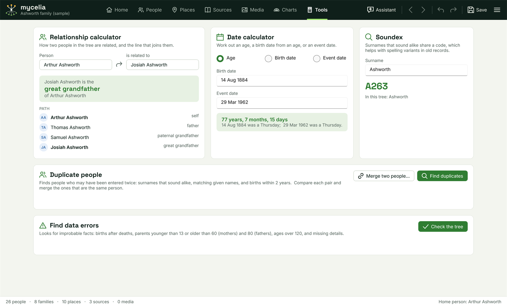

[Help home](README.md)

# Tools

The Tools workspace holds the calculators and checks that work across the whole tree: relationships, dates, Soundex, duplicate people and data errors.  This page also covers the tree tools in the main menu: merging people, find and replace, converting names, sorting children, the relationships list, fact types and historical events.

Open the workspace with the **Tools** tab in the top bar, or Ctrl+7.  Ctrl+D also opens it, for the date calculator.

The main menu is the menu button at the right of the top bar.

## Relationship calculator

Shows how two people in the tree are related, and the line of people that joins them.

1. Click the button under **Person** and choose the first person.  When you open the workspace, this is the home person.
2. Click the button under **is related to** and choose the second.  When you open the workspace, this is the person selected in the People workspace.

The answer reads, for example, "Josiah Ashworth is the great grandfather of Arthur Ashworth".  The swap button between the two people exchanges them, so you get the relationship the other way round.

Under **PATH**, every person on the line between them is listed with how they are related to the first person.  Click anyone in the path to go to them in the People workspace.

Relationships are worked out through parents, children and spouses.  Blood relatives come first: parents, grandparents ("paternal grandfather"), uncles and aunts, nephews and nieces, and cousins by degree and removal ("2nd cousin 1x removed"), with "half" where the line passes through half-siblings.  Step, foster and guardian links are not followed for blood relationships.  When there is no blood line, relationships by marriage are named, such as "father-in-law", "stepson" or "husband of 1st cousin".  Two people with no line between them are shown as **Not related**.

## Date calculator

Choose one of three modes at the top:

- **Age**: enter a **Birth date** and an **Event date** to get the age at the event in years, months and days.
- **Birth date**: enter an **Event date** and an age in **Years**, **Months** and **Days** to work out when someone was born, for example from an age given in a census or on a gravestone.  The result suggests recording it as a calculated date, such as "Cal. 14 Aug 1884".
- **Event date**: enter a **Birth date** and an age to work out the date of an event.

Each result also gives the day of the week.  Dates must include a year; a missing month or day is taken as the first.  Dates are read the same way as in facts, following the date input setting in [Options](options-and-updates.md#dates-and-names).

## Soundex

Type a surname to see its Soundex code.  Surnames that sound alike share a code, which helps with spelling variants in old records: Ashworth and Ashwerth both give A263.  Underneath, the calculator lists the surnames in your tree that share the code.

## Duplicate people

Finds people who may have been entered twice.

Click **Find duplicates**.  Mycelia compares people whose surnames sound alike and lists the likely pairs, closest first, each with the reason, such as "similar name, both born 1856, same birth place".  A pair is listed when:

- the sexes do not conflict;
- the first given names match, are a known short form of each other (Wm and William, Thos and Thomas, Eliz and Elizabeth), one starts the other, or one is the other's initial;
- the birth years are no more than 2 years apart, when both are known (with no birth years, the whole given names must match);
- neither is the other's parent, child or spouse.

At most 500 pairs are shown.  Click **Compare and merge...** on a pair to open the merge window with the two people in it.  When you close it, the search runs again.

Main menu > Tools > Find duplicate people... opens this workspace and runs the search.  **Merge two people...** in this card opens the merge window with the selected person.

## Merging two people

When the same person has been entered twice, merge the two records into one.  Open the **Merge two people** window from any of these:

- Main menu > Person > Merge two people...
- the merge button in the person panel of the People workspace (tooltip "Merge with another record of the same person...")
- **Merge two people...** or **Compare and merge...** in the Tools workspace

The window shows the two records side by side.  The left one, under **KEEP THIS RECORD**, stays; the right one, under **MERGE INTO IT, THEN REMOVE**, is merged into it and removed.  Click the button at the top of either side to choose a different person, and use the swap button between them to keep the other record instead.  Each side shows sex, birth, death, parents, spouses, the number of children, and the number of facts and citations, so you can check they are the same person.

Click **Merge**.  Then:

- Gaps on the kept record are filled from the other: given names, surname, suffix, an unknown sex and a missing portrait.  A different full name is kept as an "Also Known As" fact.
- A record marked Private on either side stays Private.  Notes are joined.
- Facts that match are combined into one: the fuller date, a missing place or description, the notes and any new citations are added to the kept fact.  Facts that do not match are added, as alternative facts where the kept record already has one of that type.
- Parents, spouses, children and media links move to the kept record.  When both records were in a family with the same partner, the two families become one.
- If the removed record was the home person, or was in the history, the kept record takes its place.

The merge is one step: Undo (Ctrl+Z) reverses all of it.

## Find data errors

Click **Check the tree** to look for improbable facts and missing details in every person.  The summary gives the number of possible errors and missing details, and how many people they concern.  Below it, each person with a problem is listed with the problems, possible errors first.  Up to 300 people are listed.  Click a person to go to them in the People workspace.

The checks look for:

- **Births:** born after their own death; born when the mother was under 13 or over 60, or after she died; born when the father was under 13 or over 80, or more than 330 days after he died; a birth after any of the person's other main facts; a parent born after their child, or less than 13 years older.
- **Ages:** an age at death over 120; married under 13; a spouse under 13 at the marriage.
- **Deaths and burials:** a marriage after the death; a burial before the death; a death before a child's birth (for a father, more than 330 days before).
- **Marriages:** a marriage after the death of either partner; a divorce before the marriage.
- **Every fact:** a date before the person's birth; a date that cannot be read as a date; a fact with no date, place or description.
- **Duplicate facts:** two facts that can only happen once, such as two births or two burials; or two facts of the same type whose details all agree.
- **Names:** a word starting or ending with a dash; characters names do not normally have, such as ! @ # or /; the same surname as their preferred spouse.
- **Relationships:** the same couple recorded as two families; a child linked as the natural child of the same parent in two families, which usually means one of those families has the other parent missing; a record with no name, or only "?" or "Unknown".  **Combine with...** and **Make unknown spouse** on the person's Family tab put these right; see [The People workspace](people.md#family).
- **Missing details:** no birth date; no marriage date when the preferred relationship is of the type Spouse; children not in birth order; sex unknown; a person attached to nobody in the tree.

Dates are compared only as far as both are known: two dates that give only years are compared by year.  Date ranges and text that is not a date are not compared.

The same checks run on the person you are editing in the People workspace, and show in a box at the top of the person panel.  That box can be turned off in [Options](options-and-updates.md#warnings); this check works either way.

## Find and replace

Main menu > Edit > Find and replace... (Ctrl+F) searches the whole tree for words and replaces them in one step.

1. Type what to look for in **Find** and, if you want, tick **Match case** or **Whole words only**.
2. Click **Find** (or press Enter).  Every field that holds the words is listed with whose it is and which field.
3. Untick anything that should stay as it is.
4. Type the new words in **Replace with** and click **Replace ticked**.

The search covers names, person and couple notes, fact descriptions and notes, citation details and extracts, place names, source titles, authors, publishers and comments, and media captions and descriptions.

Changing the words to find, or either tick box, clears the list, so you never replace from an earlier search.  Clicking **Replace ticked** with no list searches first and replaces everything found.  Undo reverses the whole replacement.

## Convert names

Main menu > Tools > Convert names... rewrites every name in the tree in mixed case.  Choose **First Middle Surname** or **First Middle SURNAME** and click **Convert**.

- Each word gets a capital first letter and the rest in lower case.
- Mc, Mac and O' names keep their inner capital: McDonald, MacKenzie, O'Brien.
- Dotted initials such as "J.R." stay in capitals, and single letters are capitals.
- Each part of a hyphenated name is converted on its own.
- "of" and "or" in given names stay in lower case.
- Only given names and surnames change.  Suffixes are left as they are.

Mycelia tells you how many names changed.  Undo reverses it.

To show surnames in capitals without changing them, use **Show surnames in capitals** in [Options](options-and-updates.md#dates-and-names) instead.

## Sort all children by birth

Main menu > Tools > Sort all children by birth... puts the children of every family in birth-date order.  Children with no birth date go after the others, in the order they were in.  Mycelia tells you how many families were reordered.  Undo reverses it.

## Relationships

Main menu > Edit > Relationships... lists every couple in the tree, by the first partner's name, with the type of relationship, its status, the marriage date and the number of children.  Type in the box at the top to narrow the list by name.

Select a couple and click **Go to**, or double-click it, to go to the first partner in the People workspace.  The list is for finding couples; to change a relationship, use the **Family** tab of the person panel.

## Manage fact types

Main menu > Edit > Manage fact types... lists every fact type: the built-in ones and your own.  Each shows whether it belongs to one person (**Individual**) or to a couple (**Shared (couple)**), and how many facts use it.

- Built-in types cannot be changed.
- Click **New fact type** and give it a name (for example "Apprenticeship") to make your own.
- For your own types you can change the **Name**, choose what it **Belongs to** (only while no fact uses it), and tick **Has a date and place** or leave it unticked for a type that holds only a value.
- **Delete this type** removes one of your own types, once no fact uses it.

Your own fact types are saved with the tree and written to GEDCOM files.  Changes take effect at once, and Undo reverses them.

## Historical events

Main menu > Edit > Historical events... keeps a list of events in history, such as wars, censuses and changes in the law.  They appear on each person's timeline in the Person view when they happen during that person's life.

- **Add event** adds a new event to edit.
- **Add the standard list** adds 17 events from 1801 to 1969, mostly for Britain and Ireland.  Events already in the list are skipped.  The sample tree starts with them.
- For each event you can edit the **Title**, **Date**, **Until (optional)** for an event that lasted a while, **Region**, **Category** and **Description**.
- **Delete this event** removes it.

Historical events are saved with the tree.  The Person view's timeline also has a **Historical events...** button that opens the same window.

## Related pages

- [The People workspace](people.md)
- [GEDCOM, merging and backups](gedcom-and-backups.md): merging another tree, then finding the duplicates it brings in.
- [Keyboard shortcuts](keyboard-shortcuts.md)
