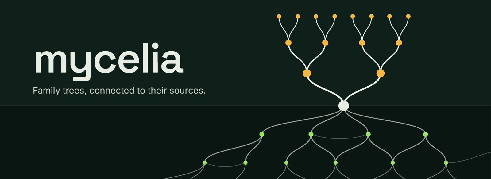
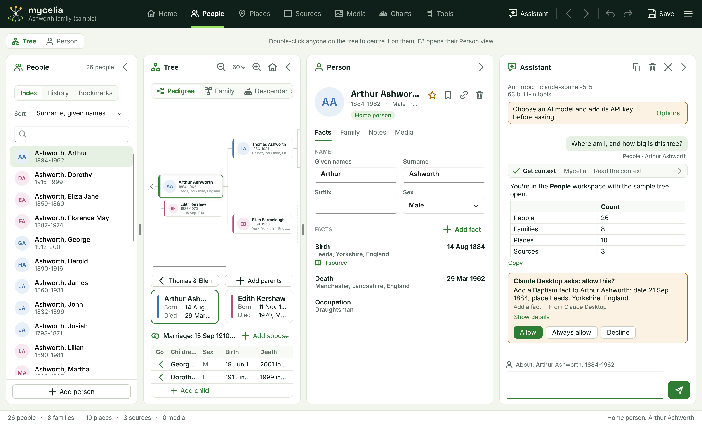
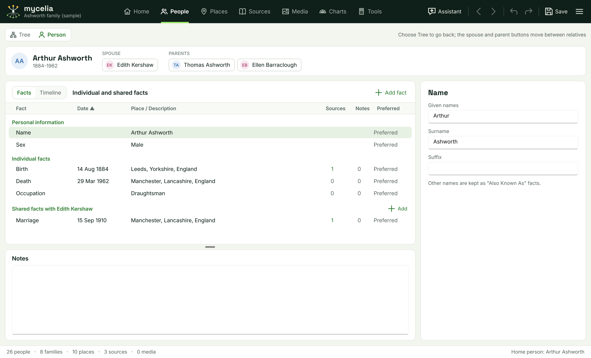

Mycelia is a Windows desktop program for recording a family tree: people, families, facts,
places, sources, media and charts, with GEDCOM 5.5.1 import and export.  It includes an
Assistant that can read and edit your tree and, through MCP servers, search record archives and
catalogues.

A mycelium is the underground network that links trees and feeds them.  In Mycelia, archives and
MCP servers do that for a family tree.  MCP also stands for "Mycelia Connects Pedigrees".



> **Status:** version 0.2.0, in development.  Ready-built versions for testing are on the
> [Releases page](https://github.com/paulfilkin/mycelia/releases) (see [Download](#download)).
> The tree file format may still change.

## Familiar, but different

If you have used Family Tree Maker, or another desktop genealogy program, Mycelia will feel
familiar: an index of people, a tree, a person's facts with dates, places and sources, dates such
as "Abt. 1850", relationships such as "2nd cousin 1x removed", checks for unlikely dates, and the
usual keyboard shortcuts.

Underneath, it works differently.  Your tree is an open file on your computer, with no account,
subscription or cloud copy.  And research doesn't have to mean hours of searching and copying: the
Assistant works out what is missing, suggests where to look, searches archives, and adds what it
finds with a citation to the record, while you approve every change.  The
[design considerations](Docs/Design/Design_Considerations.md) say more, and set out the
conventions Mycelia follows.

## What it does

- **People.**  An index with search, history and bookmarks.  Pedigree, family and descendant
  views, and a person panel for facts, family, notes and media.  A Person view with the full facts
  table, a timeline with historical events, and the relatives one click away.
- **Facts and sources.**  Over 60 fact types, each with a date, place, description and note, and
  your own types.  Dates are kept as typed ("Abt. 1850", "Bet. 1850 and 1855") and read for
  sorting and checks.  Citations with detail, a web address, the date accessed and an extract.
- **Places, Sources, Media and Charts.**  Each place with its people and events.  Sources and
  repositories, with every citation.  Pictures and documents linked to people.  Printable
  pedigree, descendant, fan and family group charts, saved as pictures or printed.
- **Tools.**  A relationship calculator ("2nd cousin 1x removed"), a date calculator, Soundex,
  duplicate people with merging, a data-error check (parents too young, births after deaths and
  so on), find and replace, name conversion and sorting children by birth.
- **GEDCOM 5.5.1.**  Import and export, with options to leave out private people and facts,
  privatise living people or export one branch.  Merge another tree, and back up and restore with
  media.
- **Undo** for every change, 60 steps deep.

### The Assistant

Ask in plain words: "complete the missing details for this person", "who are Josiah's
grandchildren?", "find this baptism in the archives".  The Assistant uses Mycelia's own tools
(65 of them) and the tools of any MCP servers you add.

- **Your choice of AI model:** Anthropic, OpenAI, or any service with the OpenAI chat interface,
  including local ones such as Ollama and LM Studio, where nothing leaves your computer.
- **You approve every change.**  Each change says what it will do and waits for Allow, Always
  allow or Decline.  Every change is an undo step, and a whole request can be reverted.
- **Research.**  It suggests where to look, reads open archive APIs, downloads records into the
  tree's media folder, and cites each record with its web address, the date and an extract.  It
  only searches records for people who have died.
- **MCP Helper.**  Adds archives' own MCP servers, such as Open Archives (the Netherlands and
  Belgium) and Riksarkivet (Sweden), including servers that sign in through the browser.
- **Other programs.**  Claude Desktop, Claude Code and other MCP clients can use Mycelia's tools
  too, with the same approvals.  This is off until you turn it on.



## Privacy

- Your tree is a file on your computer.  Mycelia has no account and no cloud copy.
- The Assistant sends nothing until you ask it something.  Then it sends your request and the
  parts of the tree its tools read to the AI service you chose.  By default the model gets only
  the names of living people and nothing about people or facts marked Private; Options ›
  Assistant changes this.
- API keys, sign-in tokens and Assistant conversations are encrypted for your Windows account.
- The update check asks the publisher's server for the latest version and installs only releases
  signed with the publisher's key.

## Download

You don't need to be a developer to try Mycelia.

1. Open the [Releases page](https://github.com/paulfilkin/mycelia/releases).  Versions marked
   "Pre-release" are test builds.
2. Under **Assets** on the newest release, download `MyceliaSetup-<version>.exe`.
3. Run it.  It installs Mycelia for your Windows account only, without administrator rights, and
   includes everything it needs.

The installer is not code-signed, so Windows may show "Windows protected your PC".  Click
**More info**, then **Run anyway**.

After that, Mycelia finds and installs new versions itself, and checks each one against the
publisher's signature first.  To report a problem or suggest an idea, choose Main menu > Help >
Report a problem or suggest an idea..., or open the
[Issues page](https://github.com/paulfilkin/mycelia/issues).  Both need a GitHub account.

## Requirements

- Windows 10 or 11, 64-bit.
- To build: the [.NET 10 SDK](https://dotnet.microsoft.com/download).  There are no other
  dependencies and no NuGet packages.

## Building from source

```
git clone https://github.com/paulfilkin/mycelia.git
cd mycelia
dotnet build Mycelia.sln -c Debug
dotnet run --project familyTree/Mycelia.csproj
```

It opens a sample tree, an invented family, the first time.  To build the installer, publish a
self-contained build and compile `familyTree/Mycelia.iss` with
[Inno Setup 6](https://jrsoftware.org/isinfo.php):

```
dotnet publish familyTree/Mycelia.csproj -c Release -r win-x64 --self-contained true
"C:\Program Files (x86)\Inno Setup 6\ISCC.exe" familyTree\Mycelia.iss
```

The project folder is still called `familyTree`, the program's name before 11 November 2026.

## Documentation

- [Help](Docs/Help/README.md): how to use Mycelia, from getting started to the Assistant.  In the
  program, F1 opens the page for the screen you're on.
- [Design record](Docs/Design/TDD_Mycelia_v0_2_0.md): the data model, file format, undo, GEDCOM,
  kinship, data checks, every workspace, the Assistant and what isn't built yet.
- [Changelog](Docs/CHANGELOG_Mycelia.md).
- [Design considerations](Docs/Design/Design_Considerations.md): what Mycelia is for, where it
  feels familiar and where it differs, and the conventions it follows (date formats, relationship
  wording, data-check limits, sort orders).
- [Genealogy resources](Docs/Resources/genealogy-resources.md): research sites worldwide, with
  their cost, API and MCP availability.

## Contributing

Bug reports, ideas and pull requests are welcome.  See [CONTRIBUTING.md](CONTRIBUTING.md) and the
[Code of Conduct](CODE_OF_CONDUCT.md).  Report security problems privately, as
[SECURITY.md](SECURITY.md) describes.

## Licence

The code is released under the [GNU General Public License v3.0](LICENSE).  The Mycelia name, mark,
icon and artwork are not covered by that licence: see [TRADEMARKS.md](TRADEMARKS.md).  Inter and
Space Grotesk are used under the SIL Open Font License 1.1 (`familyTree/Resources/Fonts`).

Mycelia is independent and is not affiliated with or endorsed by the makers of Family Tree Maker.
Family Tree Maker is a trademark of its owner.
